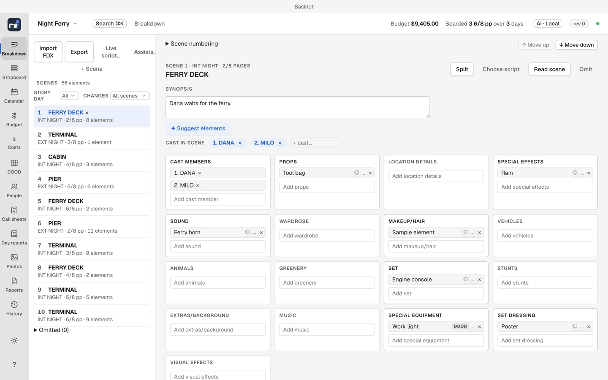

# Breakdown

Breakdown tags each scene's cast, props, vehicles, special equipment and other production elements. Backlot counts page eighths and records which characters appear in each scene. The stripboard, schedule, budget and call sheets all read from here, so tag first.

## Bring in a script

Script import needs separate reading tools that the current installer does not include. If the startup notice names missing script tools, use [manual scene entry](getting-started.md#add-one-scene-without-importing-a-script) for now. FDX and Fountain both need the reader; AI setup does not install it.

1. Breakdown, then choose Import FDX (Breakdown · `⌘1`).
2. Choose an `.fdx` or a `.fountain` file.
3. Review the proposed scene and cast changes, then choose Confirm import to bring in the scenes and tags.
4. An FDX with breakdown tags arrives with its elements attached (Final Draft's tag data travels in FDX files). A Fountain file has no tags, so its scenes arrive with none.

## Tag the elements

Each scene's elements are grouped in the standard categories: cast members, background actors, stunts, vehicles, props, special effects, wardrobe, makeup/hair, animals, music, sound, set dressing, visual effects and miscellaneous.

1. Select a scene.
2. Add each element the scene uses, in its category.
3. Backlot keeps character appearances from the script's dialogue automatically.

Page eighths are counted from the scenes: Backlot writes two and five eighths as 2 5/8, the same as paper stripboards.

## Reading a script while it is written

Breakdown has Live script… to follow a Cold Open draft as it is written; see [Script import, revisions and live script](script-import-and-revisions.md).

## What comes next

When every scene has its elements, move to the [stripboard](stripboard.md) to arrange the shooting order.
