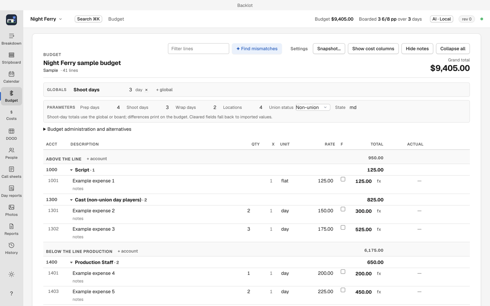
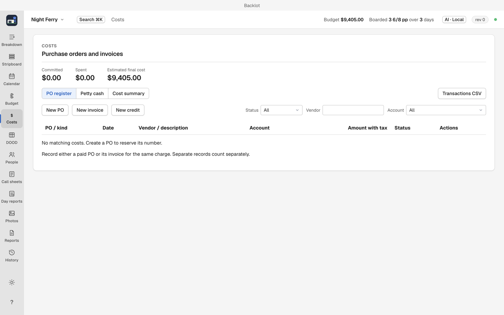

# Budget and costs

The Budget view (`⌘4`) plans spending. The Costs view (`⌘5`) records what actually went out. Both live in this guide page.

## Build the budget

1. Add accounts, then lines under them.
2. Lines support arithmetic expressions.
3. Lines can take a global value, for example Shoot days. Changing the global re-prices every line that uses it. The global does not follow the board: the Mismatches row in the Budget view tells you when it, or a day-priced line, disagrees with the board's day count.
4. Add rates and fringes per line. The union status from project creation sets the SAG agreement.

Keyboard basics in the budget grid: `⌘Enter` adds a line below the current line, Enter commits and moves down, Tab moves to the next field, and `1,000` is accepted as 1000.

## Alternatives

An alternative is a full second plan. Making one copies lines and rates, never money spent: every alternative shows the same actuals, so switching alternatives changes the plan and can never change what was spent. Compare a five-day and a six-day shoot by flipping between alternatives. The active alternative is marked; Budget administration and alternatives shows the list and switches it.

If a project saved in an older version had separate actuals per alternative, Backlot keeps the active budget's actual when the alternatives disagreed, and the line's notes record what the others had.

## Actuals, EFC and cents

Each line, account and section reports four figures: committed, spent, forecast and variance against budget. All amounts store in whole cents.

- Type an actual or an estimated final cost (EFC) override on a budget line. It counts for that line's account, once for the project, in every alternative. In an alternative without that line, the actual still counts toward the account, on a row marked "not in this alternative"; the × on that row clears it in every alternative.
- A posted purchase order, invoice or receipt on the line replaces a typed actual with what was posted, credits included.
- A posted credit alone reduces the typed actual: type $500.00, post a $50.00 refund, and the line shows $450.00.
- Drafts and voided records change nothing.

## Purchase orders, invoices, petty cash

1. Raise a purchase order to reserve a number before committing.
2. Enter an invoice when the bill arrives; then approve, receive, pay or void it.
3. For petty cash, issue an envelope to a contact and reconcile it later.

## Which board am I looking at

When a total surprises you, check the active board (Board menu, Stripboard) and the active alternative (Budget administration and alternatives) before anything else. See [Troubleshooting](troubleshooting.md).

