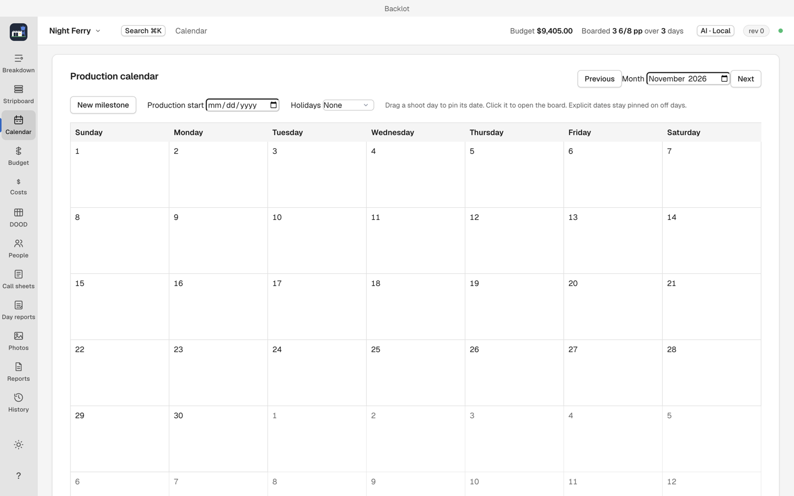

# Calendar

The Calendar (`⌘3`) gives the board dates.

1. Arrange the scenes and day breaks on the Stripboard.
2. In Calendar, set Production start. Shoot days now appear on dates.
3. Drag a shoot day to another calendar date, or choose Change date, to pin it there.
4. Choose US federal under Holidays to show those holidays while planning.

Call sheets and the day out of days read these dates, so set them before either is produced. Day reports and the production calendar report inherit the same dates.
