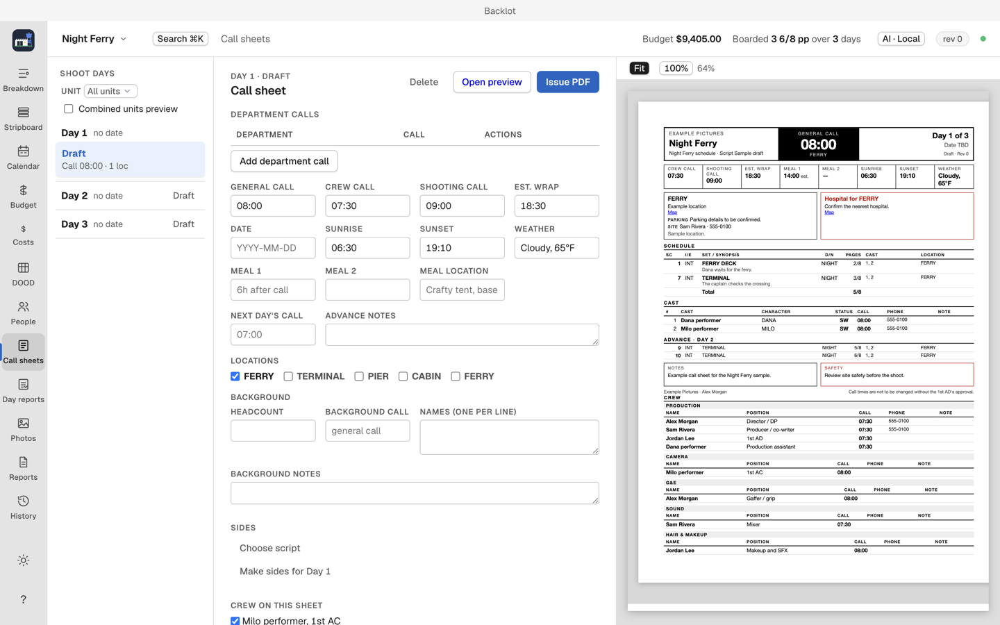

# Call sheets

Call sheets are drafted for a shoot day, filled from the board, contacts and locations, then issued and distributed. (`⌘8`)

## Draft one

1. Choose the shoot day on the calendar.
2. Backlot fills the sheet with that day's strips, cast and location.
3. Add call times, department calls and notes.
4. Issue the sheet: Backlot produces a fixed PDF that cannot be edited afterward.

## Distribute

Issue a call sheet, then send it by email, as a text message, or as a phone-friendly published page. Recipients confirm receipt from their copy, and you can remind anyone who has not confirmed.

Confirmation links need the deployed confirm pages and a shared secret (see [Setup and AI providers](setup-and-ai.md#email-and-confirmation-links)); without them, save the issued PDF and attach it manually in your own mail app. Backlot's distribution panel has no attachment-only email mode.

## Corrections

To change an issued sheet, issue a correction. Backlot marks the change inside the corrected sheet; the original stays as issued. Then choose Distribute for the new issue and send it to the recipients. Issuing alone does not notify them.

## Delivery history

Each issue keeps a delivery history with one row per attempt and its outcome.

1. Retry failed deliveries from the history.
2. Send the same issue to recipients added late.
3. Remind recipients who have not confirmed.
4. A delivery with an unknown outcome must be resolved before retrying, so one retry cannot become a duplicate send.

## Video walkthrough

[Draft and preview a call sheet](videos/call-sheets.mp4) · [Captions](videos/call-sheets.srt). See [video notes and draft narration](videos/index.md).
