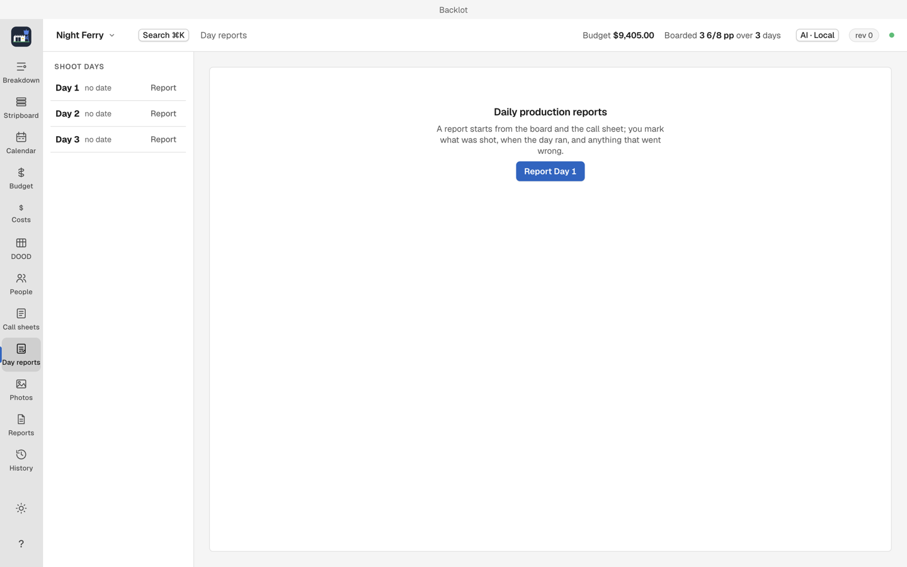

# Day reports

After wrap, file the day's daily report and enter the day's costs. (`⌘9`)

1. Open Day reports for the shoot day.
2. Record pages shot, working times and incidents.
3. Enter costs as you incur them, in [Costs](budget-and-costs.md#purchase-orders-invoices-petty-cash).
4. Attach production photos in the Photos view when you want them with the day's records.

In Day reports, choose Open preview to inspect the production form, then Save PDF to save it. The cost report in [Reports](reports-and-exports.md) tracks financial figures; enter spending separately in Costs.
