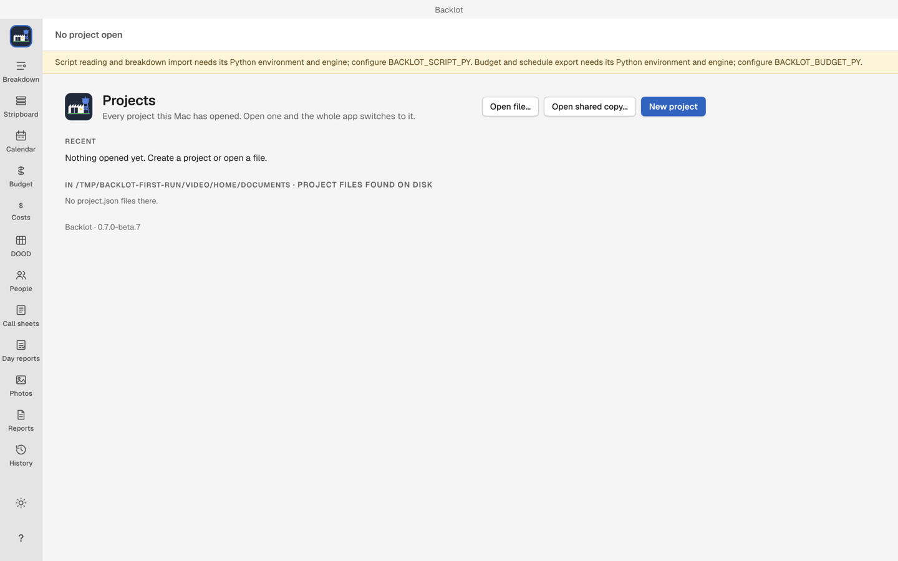
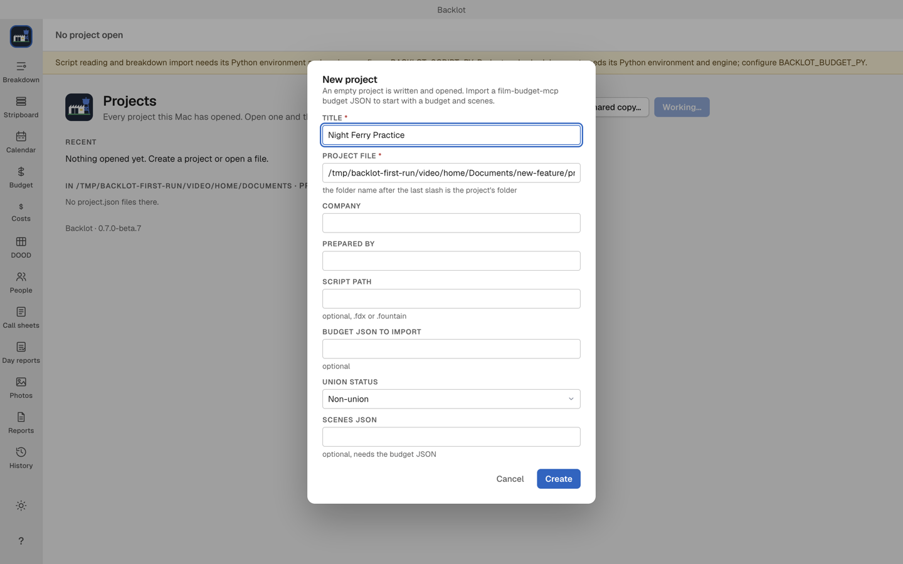
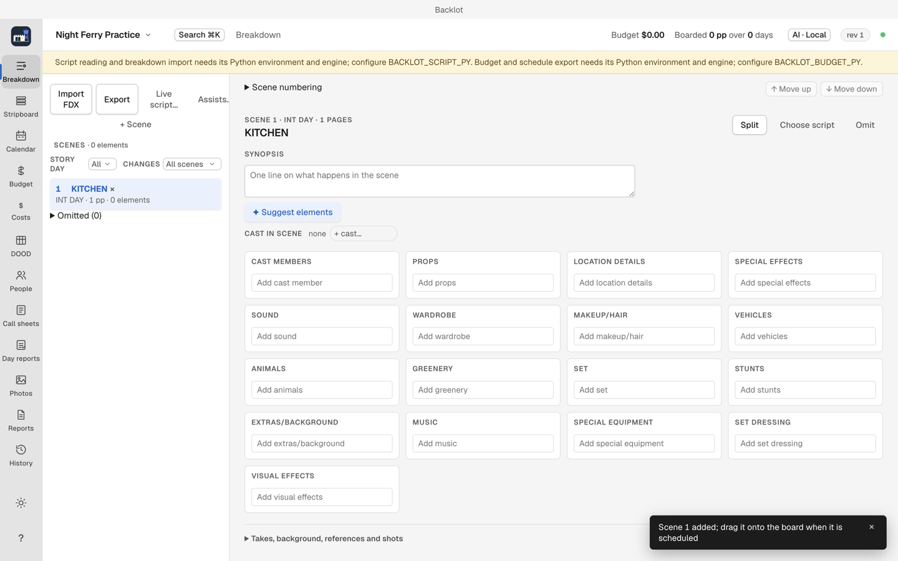

# Getting started with Backlot

Start by making one empty project and adding a scene. This needs Backlot alone. AI, script import, printing and email have separate setup, so you can leave them until you need them.

The downloadable app requires an Apple silicon Mac running macOS 13 or later.

## Install without using Terminal

1. Open the [Backlot downloads page](https://github.com/MIM18-code/homebrew-backlot/releases/latest).
2. Under Assets, click the file whose name ends in `.dmg`. The source archives are for developers.
3. Open the downloaded file. Drag Backlot to the Applications shortcut in the installer window.
4. After copying finishes, eject the Backlot installer in Finder.
5. Open Applications, then double-click Backlot. If macOS asks whether to open an app downloaded from the Internet, click Open.

If the app will not open, download a fresh DMG from that page and copy it again. If it still fails, report the exact message with your Mac model and macOS version on the [public Backlot issue tracker](https://github.com/MIM18-code/homebrew-backlot/issues). You do not need to change security settings to follow this guide.

The app does not update itself. To update without Terminal, repeat these steps with the newer DMG and choose Replace when Finder asks about the existing app.

## Your first launch



Projects is the starting screen. On a new installation, Recent says Nothing opened yet. Create a project or open a file. An empty list is expected.

You may see a yellow notice about missing script-reading or budget-export tools. That notice does not prevent making a project, adding scenes by hand, arranging the board or editing a budget. It does mean the named import or export feature is unavailable. Setting up AI does not fix those tools.

The current installer has no point-and-click setup for the missing script-import tools. You can continue with the manual example below. See [what is required for each task](setup-and-ai.md) before trying an import.

## Make an empty practice project

Use the title Night Ferry Practice for this example.

1. Click New project.
2. Click Choose folder. Choose an empty folder where you want to keep this practice project. You can make one in Finder with File > New Folder, then select it in Backlot's folder window. Apple's [folder instructions](https://support.apple.com/guide/mac-help/mh26885/mac) show that step.
3. Enter Night Ferry Practice in Title.
4. Leave the generated Project file value unchanged for this first project. Backlot has filled in the file location for you.
5. Leave Company, Prepared by, Script path, Budget JSON to import and Scenes JSON blank. They are optional.
6. For this fictional practice project, choose Non-union under Union status. For a real production, choose its actual status, or Unknown until you have confirmed it. A SAG-AFTRA project also asks for its SAG agreement.
7. Click Create. Backlot opens the new project on an empty Stripboard.



The current form shows technical file and JSON fields even when you only want an empty project. Leaving those optional fields blank is the intended route here. Choosing a script path attaches a source file; it does not import scenes.

Keep the whole project folder when you back it up or move it. Its project file, attachments, journal and saved documents belong together.

## Add one scene without importing a script

1. In the left sidebar, click Breakdown.
2. Click Add scene.
3. Enter `1` for Scene number and `INT. KITCHEN - DAY` for Slug line.
4. Leave Pages (eighths) at `8`, which means one page. Optionally add a short Synopsis.
5. Click Create. The scene is now in the breakdown.
6. Click Stripboard to start arranging your scenes. The new scene waits in the unscheduled drawer until you add it to the board. Follow [Stripboard](stripboard.md) when you are ready to build shooting days.



A created scene is saved in the project folder. You can stop here and return to the project later. No AI account or model download is required for these edits.

## Add optional features when you need them

| You want to | What to do next |
| --- | --- |
| Use AI suggestions | Follow [Setup and AI providers](setup-and-ai.md). You can close AI settings and keep working. |
| Import a screenplay | Read [Script import](script-import-and-revisions.md) first. A fresh installation is missing the separate import tools. |
| Save PDFs or issue a call sheet | Install Google Chrome if Backlot reports it missing, then quit and reopen Backlot. |
| Email a call sheet | Use [Call sheets](call-sheets.md). In-app delivery needs extra configuration; manual email attachments are an alternative after a PDF is saved. |

The [six-scene Fountain sample](sample/Night-Ferry.fountain) and [tagged Final Draft sample](sample/Night-Ferry-tagged.fdx) are for an installation whose script-import tools are already available. They do not install those tools.

## If a step fails

| What you see | What to do |
| --- | --- |
| Create is unavailable | Fill in Title and check the highlighted required fields. Choose Union status. |
| The project file already exists | Use Open file… to open the existing project, or start New project again and choose a different empty parent folder. Do not overwrite the existing project. |
| A script-reading or Python error during import | Dismiss the error with its × button. Continue with Add scene, or report the missing-import-tools message. Switching from FDX to Fountain or setting up AI does not repair a missing reader. |
| PDFs need Google Chrome | Install Chrome in Applications, then quit and reopen Backlot. Try saving the PDF again. |
| AI is not ready | Close the AI sheet and keep working, or follow its setup and retry steps in [Setup and AI providers](setup-and-ai.md). |

More recovery steps are in [Troubleshooting](troubleshooting.md).

## Find the next view

Click the view name in the left sidebar. Keyboard shortcuts are optional.

| View | Use it for | Shortcut |
| --- | --- | --- |
| Breakdown | Scenes and production elements | ⌘1 |
| Stripboard | Shooting order and day breaks | ⌘2 |
| Calendar | Shoot dates | ⌘3 |
| Budget | Planned spending | ⌘4 |
| Costs | Money committed and spent | ⌘5 |
| DOOD | Who works on which day | ⌘6 |
| People | Cast, crew, contacts and locations | ⌘7 |
| Call sheets | Daily calls and instructions | ⌘8 |
| Day reports | What happened on the shoot day | ⌘9 |

Photos, Reports and History are further down the sidebar. The appearance button switches Light, Dark and Match macOS. The AI pill at the top opens AI settings when you choose to use them.

## Homebrew alternative

If you already use Homebrew, you can install with these commands instead of the DMG:

```bash
brew tap MIM18-code/backlot
brew trust MIM18-code/backlot
brew install --cask backlot
```

Homebrew requires [explicit trust for third-party taps](https://docs.brew.sh/Tap-Trust). To update, run `brew upgrade --cask backlot`.

## Video walkthrough

[First launch and an empty practice project](videos/getting-started.mp4) · [Captions](videos/getting-started.srt). See [video notes and draft narration](videos/index.md).
