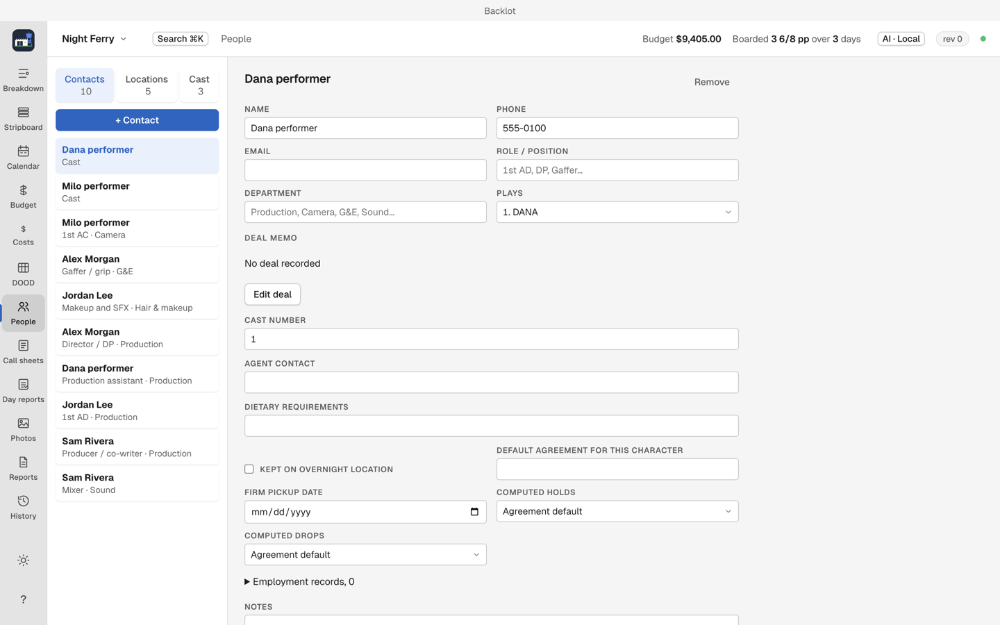
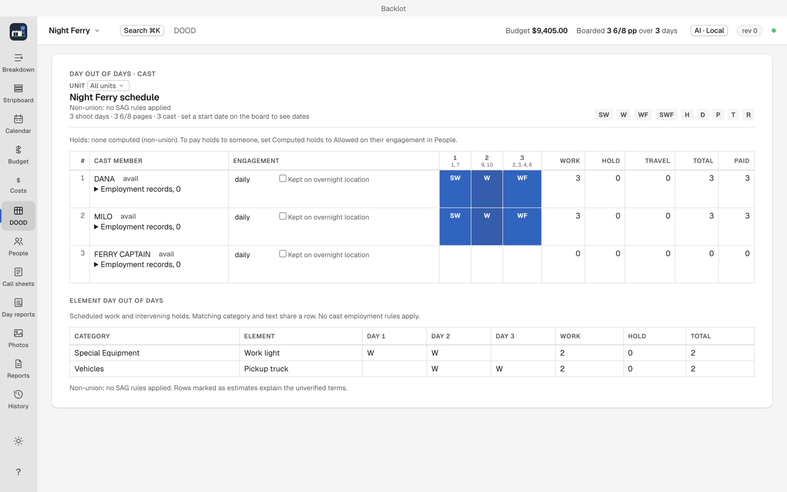

# People and the DOOD

People (`⌘7`) holds contacts, cast, crew and locations. The DOOD (`⌘6`) is the day out of days: who works when, and their holds.

## People

1. Add contacts (crew, vendors, anyone you bill or call).
2. Add cast under their contact and link the contact to the character.
3. Enter deal memos and employment dates while you are here.

A contact linked to a character appears in each call sheet's cast block with their DOOD status, so the link is what makes call sheets smart.

## DOOD

The DOOD reads the board's days, the calendar's dates and the People data: set both first ([stripboard](stripboard.md), [calendar](calendar.md)). It reports each cast member's work days, holds, and switchover/mileage as the union status demands (a non-union project disables union rules).

The DOOD prints in standard form from [Reports](reports-and-exports.md).

