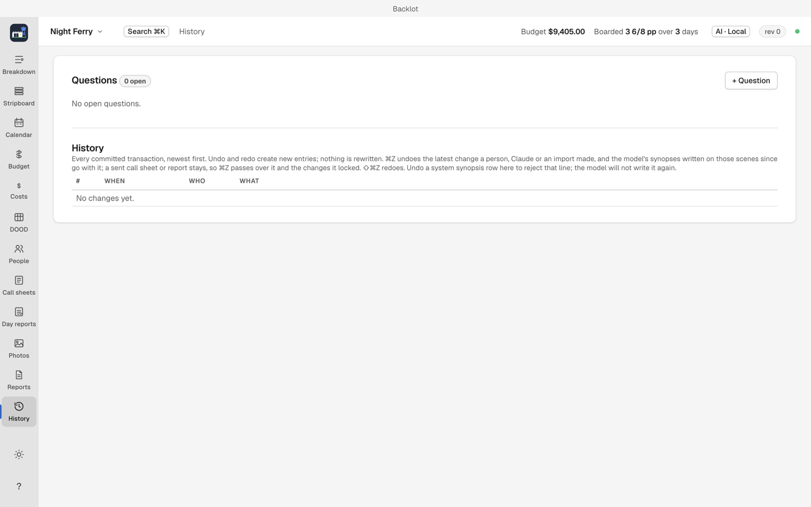

# Projects, backups, and sending a copy

A Backlot project is one folder: `project.json` with attachments, issued PDFs, the journal and the backups beside it.

## Back the right thing up

Back up the entire project folder, not `project.json` alone. Attachments and issued call sheets live beside it.

## Undo and the journal

The History view lists changes with a note and offers Undo where it is available. Press `⌘Z` outside a text field to undo the latest eligible change. Sent call sheets and reports remain sent; their delivery records and changes they lock cannot be undone. History explains other blocked actions, including gaps in the journal.

1. Undo and redo add new entries rather than rewriting existing ones, so the journal is a complete record.
2. If an undo would overwrite a later edit, Backlot blocks it and names the conflicting entry.

## Backups and restores

1. Backlot writes a backup once a day, and before risky operations such as restoring, renumbering and sorting the board.
2. The thirty newest backups of each kind are kept, so a run of sorts or imports cannot push out the daily backups.
3. Restore one from the Home view. The restore is recorded in the journal and is undoable like any other change.

Backlot asks for a confirm before sorting, renumbering and draft re-imports apply.

## Send a project

1. File > Send a Copy, or Send a copy on the Home view.
2. Backlot saves one `.backlot` file holding the project, its history, attachments, saved call sheets and reports, then offers Mail, Messages or AirDrop.
3. The other person opens the `.backlot` file with Backlot.

When they send it back and you double-click it, Backlot recognizes the project and offers to replace your copy. Your own copy is saved first, as a `.backlot` file in the project's backups folder; files you keep in the project folder stay where they are.

Backlot cannot combine two sets of edits. While the other person has the project, leave your copy alone. If both copies changed, Backlot says so before replacing, and replacing keeps only theirs; choose Open as Separate Project to keep both side by side and go back from that saved backup whenever you want.
