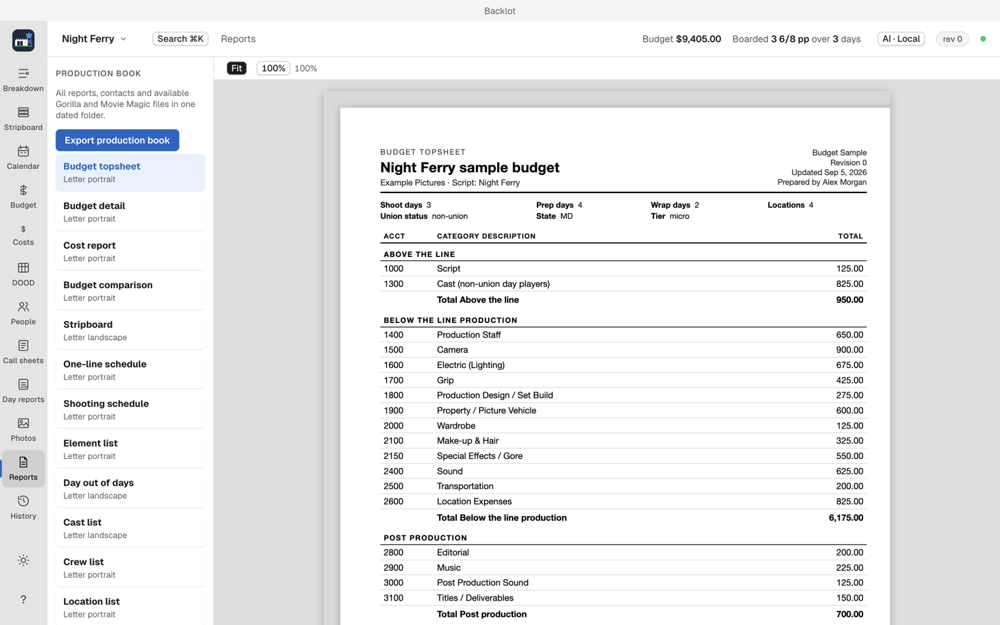

# Reports and exports

The Reports view produces everything the production office asks for, in standard printed layouts.

## The reports

Budget topsheet and detail, cost report, budget comparison, stripboard, one-line schedule, shooting schedule, element list, day out of days, cast list, crew list, location list, shot list, production calendar, cash flow by week, deal memos, editor log, purchase orders, and petty cash reconciliation.

Select a report to preview its printed layout before saving anything. The preview is what prints.

## Export production book

Export production book writes every report into one dated folder. Hand the folder to yourself, a producer, or a bond company.

## Interchange exports

| Export | Format |
| --- | --- |
| Gorilla budgets and stripboards | Gorilla-compatible |
| Budget and schedule | Movie Magic XML |
| Written file and payroll | Transactions CSV, payroll timecard CSV |

These exports are what a line producer or an accountant asks for when they want to keep working in the tools they know.

## Script imports and the Cold Open handoff

FDX with breakdown tags, Fountain files, and the "Review Draft in Backlot…" handoff from Cold Open all land in the Breakdown view; see [Script import, revisions and live script](script-import-and-revisions.md).

## Printing prerequisites

PDF printing uses a locally installed Google Chrome: see [Troubleshooting](troubleshooting.md) if reports will not print.
