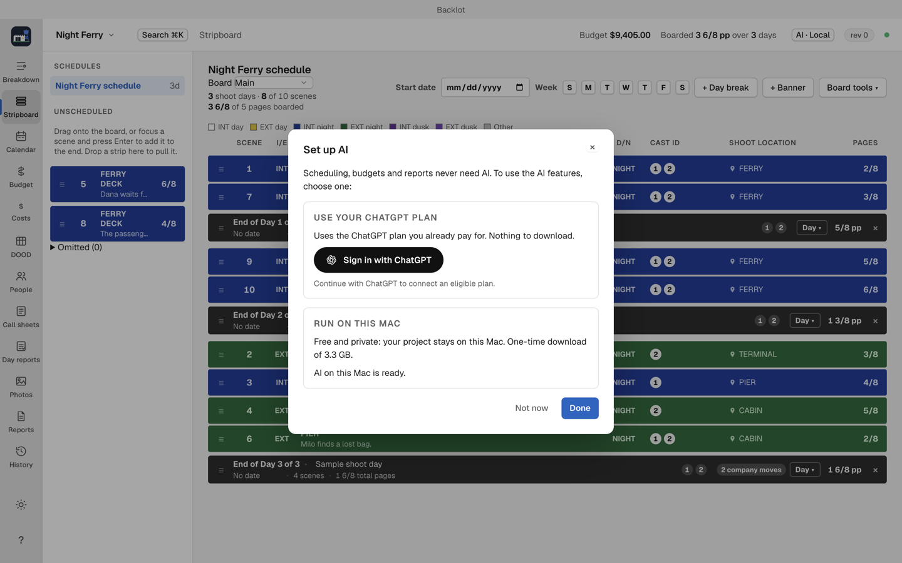

# Setup and AI providers

You can create projects, add scenes by hand, arrange a schedule and edit budgets without AI or extra downloads. Start with [the empty practice project](getting-started.md) if you have just installed Backlot.

Extra setup belongs to the feature you choose to use. A warning about one missing tool does not mean all of Backlot is unavailable.

## What each task needs

| Task | Required for this task | Required for the empty practice project? |
| --- | --- | --- |
| Manual scenes, scheduling, budgets, contacts and draft forms | Backlot | Yes |
| AI suggestions | A working local model, a ChatGPT connection with plan usage, or a supported API key | No |
| Script import, tagged FDX export and actor sides | Backlot, with its included screenplay engine | No extra setup |
| Saving PDFs and issuing call sheets | Backlot, with its included desktop PDF renderer | No extra setup |
| Gorilla and Movie Magic interchange files | Separate budget-export tools not included in the current installer | No |
| In-app call-sheet email and receipt confirmations | An email service and a configured confirmation site | No |

Backlot beta 8 includes script reading, tag writing, sides and desktop PDF output. Gorilla/Movie Magic budget and schedule interchange tools remain separate integrations, with their buttons disabled when absent. AI setup does not install those integrations.

## Choose whether you want AI

AI is optional. It helps with tasks such as suggested breakdown elements and synopses. You can dismiss its setup and continue editing the project.

| Choice | What you need | What happens to the project text you submit |
| --- | --- | --- |
| Run on this Mac | Ollama and a downloaded local model | The AI request stays on this Mac. |
| Your ChatGPT plan | Sign in and enable plan usage | The request goes to your selected ChatGPT connection under its plan limits. |
| Your own API key | A key from Anthropic, OpenAI or Google | The request goes to that provider and uses its separately billed API service. |

Pick one provider. Backlot does not silently switch between your local model, plan or API billing. Responses name the provider and model that answered. Saved account connections and keys are kept on this Mac, outside the project file. Cloud requests use that provider's connection.

## Guided AI setup

Click the AI pill at the top, then Set up AI…. The sheet also appears when an AI assist needs setup.

Older beta 7 installations have earlier provider settings and no Set up AI… button. Update to beta 8 for the current setup sheet, or use the earlier-settings notes below.

### Use your ChatGPT plan

1. Click Sign in with ChatGPT. Complete the sign-in in the browser, then return to Backlot.
2. If asked, click Enable ChatGPT plan usage. Being signed in without plan usage is not enough to run an assist.
3. If already signed in, click Use ChatGPT. Choose an available model when prompted. Backlot can reuse an existing model choice if it is still available.
4. Wait for ChatGPT is ready, then click Done.

If the browser sign-in is cancelled, return to the sheet and try Sign in with ChatGPT again. If it still says it is waiting, click Cancel sign-in first. If the account offers no models, click Try again; if the list remains empty, close the sheet and continue without AI or choose another provider. Project editing does not depend on completing this sign-in.

### Run AI on this Mac

1. If the sheet shows Download Ollama, click it. Install and open the downloaded Ollama app, then return to Backlot. This button opens the download page; it does not perform the installation for you.
2. If the sheet shows Start Ollama, click it. If starting fails, open Ollama from Applications and return to the sheet.
3. Click Download (3.3 GB) when offered. This is an optional model download, separate from Backlot's installer. Stay online while it downloads.
4. Pause stops the current download request. Resume download keeps the downloaded model data. If the download fails, use Retry download after checking the connection and free disk space.
5. If a usable local model is already present while another provider is selected, click Use AI on this Mac.
6. Wait for AI on this Mac is ready, then click Done.

Closing the sheet leaves an active model download running. Not now closes the sheet without requiring you to finish setup. A pending Breakdown request retries after setup is saved successfully.

## Public beta 7: earlier AI settings

Click the AI pill at the top. The settings list the providers directly.

- To skip AI, close settings and continue the practice project.
- For ChatGPT, choose Your ChatGPT plan and Continue with ChatGPT. Complete the browser sign-in, enable plan usage if requested, and choose an available model.
- For local AI, install and open Ollama separately, then install the model named in the settings and use Warm up now. This earlier build does not install Ollama for you. If you do not already know that setup, use the app without AI rather than changing unfamiliar settings to get through the first project.

A Claude Pro or Max subscription is not a provider option. Your own Anthropic API key is a separate route.

## Email and confirmation links

In-app call-sheet email needs an email service and a configured confirmation site. That is a separate production-delivery setup, not a first-launch requirement.

To send a sheet without that setup, save the issued PDF and attach it in your usual mail app. Backlot's distribution panel has no attachment-only email mode. See [Call sheets](call-sheets.md).

## Technical configuration reference

Technical configuration and the optional integration notes are included in the source archive on the [Backlot release page](https://github.com/MIM18-code/homebrew-backlot/releases/latest). They are not prerequisites for the practice project.
