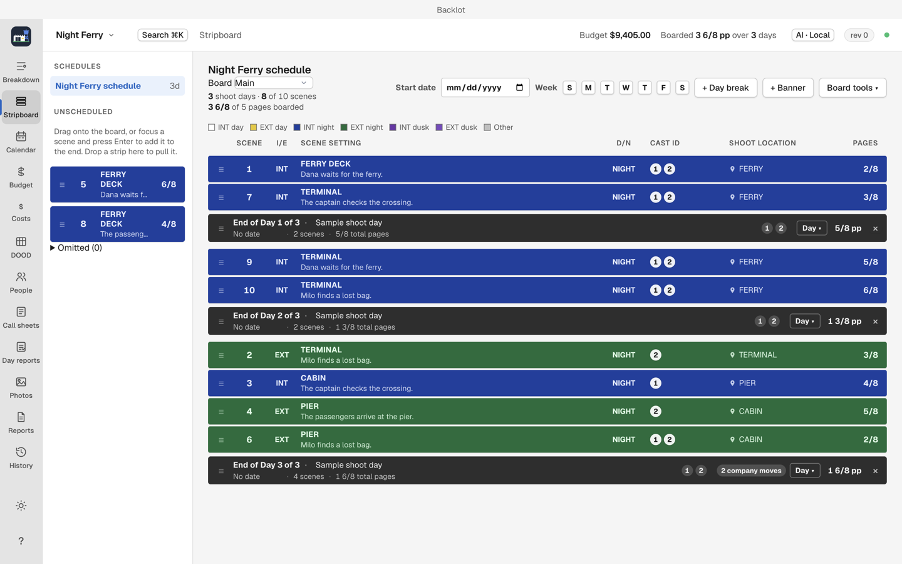

# Stripboard

The stripboard is the shooting order: scenes as strips, arranged into days. (`⌘2`)

## Reading the board

Strips show their scene number, heading, page eighths and elements. Backlot colors strips by interior or exterior and day or night, using standard paper stripboard colors: INT day, EXT day, INT night, EXT night.

Page lengths are in eighths. A day break ends the day above it and shows that day's totals in pages and cast. Unscheduled scenes wait in the left column until you drag them onto the board.

## Arrange the board

1. Drag strips into shooting order, or select several and move them together.
2. Insert day breaks between scenes to close a day. Use End day on a strip or insert a day break where the shooting day ends.
3. `⌥↑` and `⌥↓` move the focused strip (or banner or day break).
4. Enter opens the strip inspector; Esc closes it.
5. Enter on an unscheduled scene boards it.

Backlot flags days that exceed your page target, and warns when a cast member is double-booked across units.

## Sort board

Sort board groups scenes by location, set and time of day against the page target. Review the result before accepting: location availability, company moves and night shoots matter, so treat the sort as a starting draft, not a schedule. Backlot asks you to confirm the sort before applying it.

## Boards and units

The Board menu at the top of the view shows the active board. Sheets, schedule, DOOD and call sheets all read it.

## Video walkthrough

[Build a shooting schedule](videos/building-a-schedule.mp4) · [Captions](videos/building-a-schedule.srt). See [video notes and draft narration](videos/index.md).
