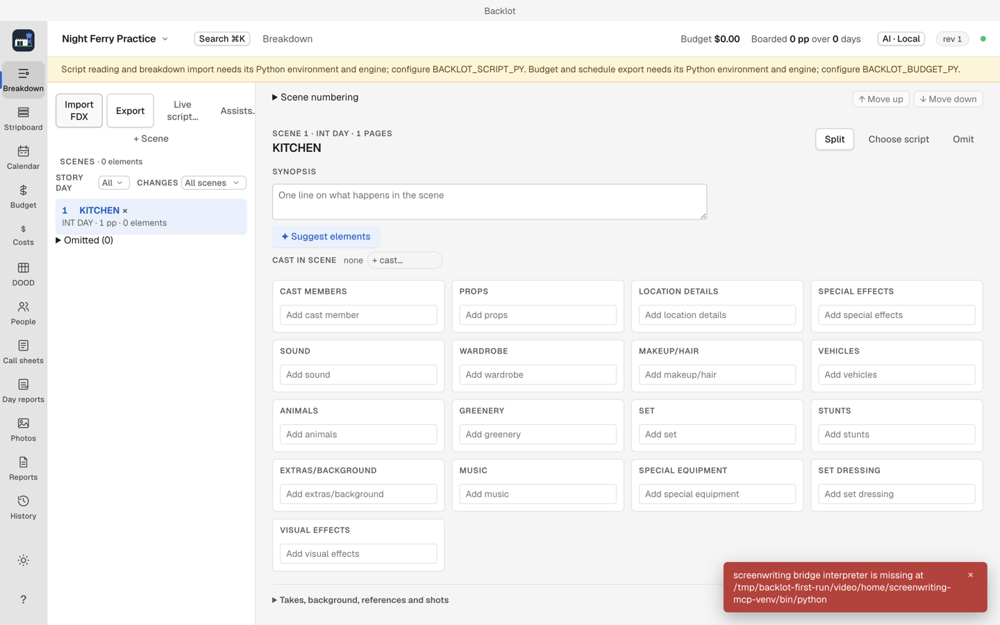

# Troubleshooting Backlot

## Unexpected totals

1. Check which board is active: the Board menu at the top of the Stripboard.
2. Check which budget alternative is active: Budget view > Budget administration and alternatives. The active one is marked.
3. Budget lines do not read the board's day count; they use the Shoot days global. The Mismatches row in the Budget view says when that global or a day-priced line disagrees with the board.
4. For dated fringes, the board's dates decide how much of the fringe is charged, so fixing the Calendar can fix the fringe math.
5. Actuals and estimated final cost overrides are the same in every alternative: switching alternatives changes budget figures, never what was spent.

## A first-launch notice mentions missing tools

Read the feature named in the notice. Script import, budget interchange exports and PDF printing have different requirements. You can still create a project, add scenes manually and work on the board or budget.

The installer currently does not provide a setup button for the separate script-import and budget-export tools. Report the missing feature and the exact message. AI setup does not install those tools.

## A project will not create

If Create is disabled, fill Title and check the required fields highlighted by the form. Keep the generated Project file location for your first project, and leave the optional script and JSON fields blank.

If Backlot says the project file already exists, choose Open file… to reopen that project. For a separate practice project, start New project again and choose a different empty parent folder. The title alone does not change the generated file location in this version.

## Reports will not save as PDF

1. If Backlot says PDFs need Google Chrome, install [Chrome](https://www.google.com/chrome/) in Applications.
2. Quit Backlot and open it again, then retry Save PDF or Issue.
3. If Chrome is already in Applications and the error remains, report the message. Choosing an unusual browser location currently requires technical configuration; the app does not offer a browser chooser.

## Script import fails

If the error says the screenwriting bridge, Python interpreter or engine is missing, the separate import tools are unavailable. The current installer does not include them or provide a point-and-click installer.

Dismiss the error with its × button and return to Breakdown > Add scene to enter scenes manually. FDX and Fountain use the same reader, so changing the file extension will not fix a missing reader. Sign-in and local AI downloads are unrelated to this requirement.

If the import tools are available but one file fails, keep the original script and report the error. An import preview must succeed before you confirm any scene changes.

## Gorilla or Movie Magic export fails

An error naming the budget bridge or its Python interpreter means the separate budget-export tools are unavailable. Your project and ordinary budget edits remain available. The app needs an installation or repair flow for this feature; changing your AI provider will not repair it.

## Call sheet delivery looks stuck

1. Open the issue's delivery history: every attempt and its outcome is listed.
2. Retry failed deliveries; resend to late additions; remind unconfirmed recipients.
3. A delivery with unknown outcome must be resolved first, by design, so retrying cannot send twice.

## Email is refused

In-app call-sheet email needs a configured email service and confirmation site. If they have not been set up for this installation, save the issued PDF and attach it manually in your own mail app. The [delivery setup notes](setup-and-ai.md#email-and-confirmation-links) explain the difference.

## An AI assist answers with the wrong provider

The provider is one explicit setting with no silent fallback. Open the AI settings from the AI pill in the top bar and check the active provider; every response names the provider that answered.

## Union status changed after project start

Recalculate. The union status set at creation drives hold calculations, the SAG agreement and DOOD assumptions; changing it later does not silently re-price what is on the board.

## A change went the wrong way

Undo it in the History view (or `⌘Z` outside a text field), or restore a backup from the Home view. Both actions are journaled, so undoing the undo is possible.

## Ask for help

Report a problem on the [public Backlot issue tracker](https://github.com/MIM18-code/homebrew-backlot/issues). Include the exact message, Backlot version, macOS version and the action you tried. Describe whether you started with an empty project or opened an existing one. You can report the error without attaching your screenplay, account keys or a production project.
