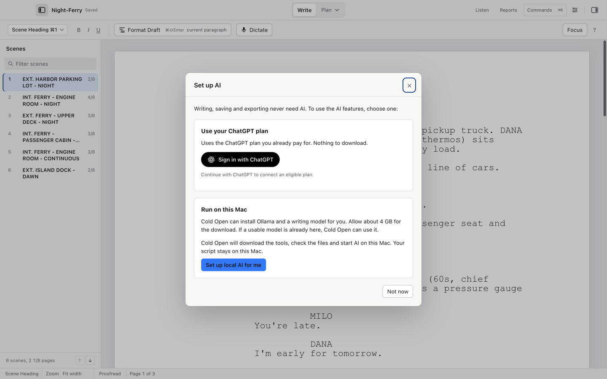
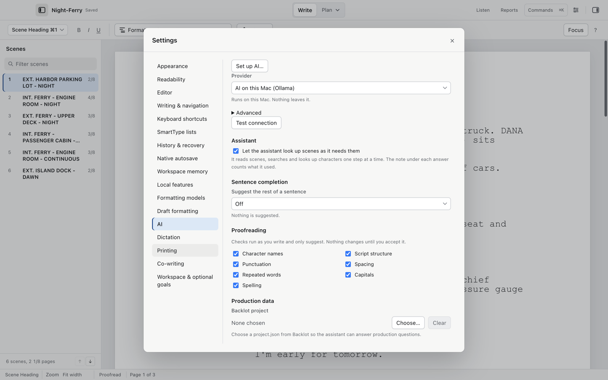

# The assistant and AI setup

Cold Open can ask questions about your script, proofread as you write, and complete sentences. Every one of these is optional: writing, saving and exports work with no AI at all. Nothing is sent anywhere until you ask, and nothing is applied without your acceptance.

## Choose a provider

Open Settings > AI (Tools > Settings…, `⌘,`):

| Provider | What it is | What it costs |
| --- | --- | --- |
| Local model (Ollama) | Runs on this Mac. Nothing leaves it. | Free. Cold Open can install the local runtime and model; an existing Ollama installation also works. |
| Sign in with ChatGPT | Uses your own ChatGPT plan through OpenAI's Sign in with ChatGPT for open-source apps | Your plan's limits |
| Anthropic (Claude) | Your own API key | Billed per use by Anthropic |
| OpenAI (API key) | Your own API key | Billed per use by OpenAI |
| Google (Gemini) | Your own API key | Billed per use by Google |

## Guided setup

Choose Tools > Set up AI…, or Set up AI… in Settings > AI. This sheet also opens when an AI request needs a local model that is not ready.

Choose one route:

- Use your ChatGPT plan: choose Sign in with ChatGPT and complete the browser sign-in. If already signed in, choose Use ChatGPT. Eligible requests use your plan after you enable plan usage.
- Run on this Mac: choose Set up local AI for me if the tools are missing or stopped. Cold Open installs and starts the runtime and gets a model if needed. Allow about 4 GB for the runtime and model download. If Ollama is already running without a model, choose Download writing model. Pause keeps completed model files; Resume model download continues a paused model download. If local AI is already ready while another provider is selected, choose Use AI on this Mac.

The public beta 8 release has the earlier local setup buttons: Download Ollama opens its installer page, Start Ollama starts an installed app, and Download (3.3 GB) gets the model. The newer setup shown above performs those steps for you.

The sheet reports when the chosen provider is ready. Choose Done, then continue your request. The assistant and breakdown suggestions retry the pending request after setup. Not now closes the sheet; writing stays available. Closing the sheet during a download leaves the download running.

Nothing downloads or changes provider until you choose it. AI setup is separate from microphone preparation and table-read voice packs.

For a different local model or address, open Settings > AI > Advanced. Choose an installed local model, then Test connection.

The status line reports readiness. "Provider reports ready" means the server answered; an individual request can still fail or hit a plan's usage limit.

## Ask about the script

Tools > Ask About the Script… opens the Ask panel. It reads your scenes, searches and looks up characters one step at a time; the note under each answer counts what it used. Quick prompts handle common jobs: Summarize scene, Check continuity across the script.

Tools > Notes on This Scene and Tools > Summarize This Scene work on the current scene directly.

## Proofreading

The Proofread panel (View > Show Proofread) checks as you write and only suggests. Nothing changes until you accept.

Its checks, each switchable in Settings > AI: character names, script structure, punctuation, spacing, repeated words, capitals and spelling. Tools > Check Scene with AI and Check Script with AI run a full pass on demand; Tools > Next Proofreading Suggestion (`⌘;`) walks the results.

## Sentence completion

Off by default. In Settings > AI choose Off, When I press `⌘Return`, or When I pause while typing. With the keyboard mode, Edit > Complete Sentence (`⌘Enter`) suggests the rest of the sentence.

## Production questions from Backlot

The Production data section in Settings > AI can point at a Backlot project:

1. Choose Choose…
2. Select the Backlot project's `project.json`.

The assistant then answers production questions with that project's data. Neither app changes anything in the other's files for this.

## AI users' first-use consent

The first time you use casting help or sentence completion on a cloud provider, Cold Open asks once before sending anything. It always names the provider that answered in the answer's header.

## Video walkthrough

[AI setup options](videos/ai-setup.mp4) · [Captions](videos/ai-setup.srt). See [video notes and draft narration](videos/index.md).
