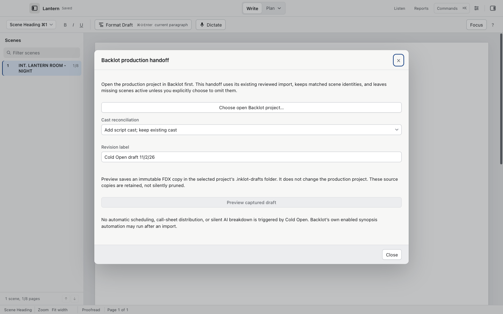
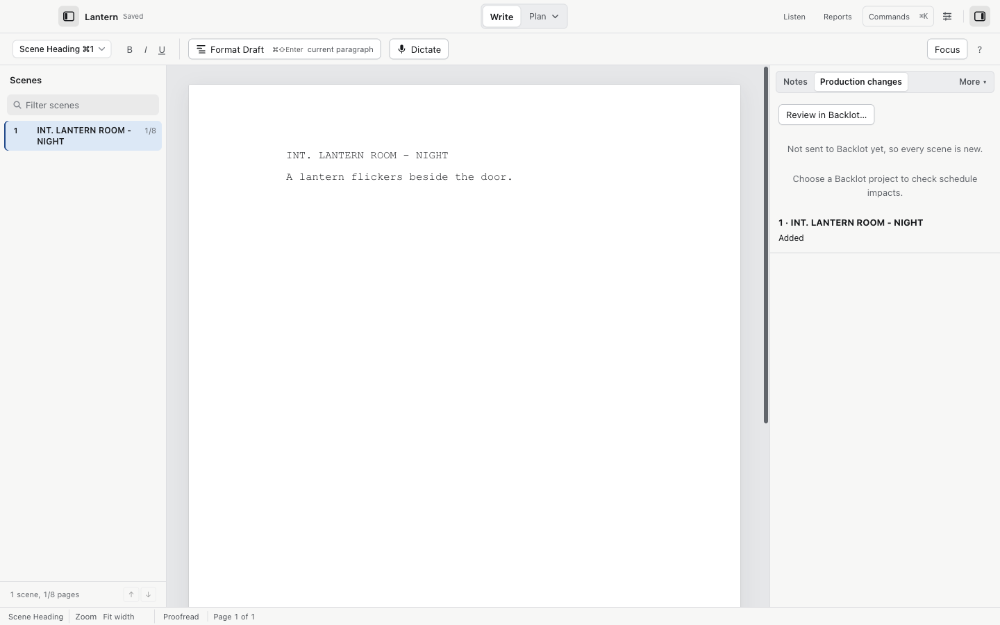

# Handoff to Backlot

Backlot is MindInMotion's production app for breakdowns, schedules, budgets and call sheets. Cold Open sends it the script, its breakdown tags, and the scene identity needed for revisions to line up.

## One-time setup

In Settings > AI > Production data: choose Choose… and select a Backlot project's `project.json`. This lets the assistant answer production questions with that project's data.

## Send the script

File > Review Draft in Backlot… opens the handoff dialog:

1. Open the project in Backlot first. The dialog lists open Backlot projects under Choose open Backlot project….
2. Choose cast reconciliation: add script cast and keep existing cast, leave cast assignments unchanged, or synchronize script cast including removals.
3. Optionally set a Revision label.
4. Choose Preview captured draft to see what will be sent.
5. Review the scene matches, cast changes and breakdown elements in this Cold Open dialog. Resolve any unmatched identities. If you change the choices, choose Review revised choices.
6. Choose Apply reviewed import… to apply the reviewed draft to the Backlot project. Then review the schedule in Backlot.

Preview saves an immutable FDX copy into the chosen project's `.inklot-drafts` folder. It does not change the production project. Cold Open triggers no automatic scheduling, no call-sheet sends and no silent AI breakdown; if Backlot's own synopsis automation is on, it may act after the import lands.

Matched scenes keep their identities from the last reviewed import, so a renamed heading stays on the same scene and missing scenes stay active unless you deliberately omit them.

## Watch production changes

View > Show Production changes opens a panel that compares this draft with the Backlot project:

- Every scene that has not been sent yet shows as Added.
- Choose Review in Backlot… to reopen the handoff.
- Choose a Backlot project to flag changed scenes that are scheduled or appear on an issued call sheet. Review those days in Backlot.

These flags come from the selected project. Backlot does not yet use the outgoing production-changes summary to recalculate schedule impacts.

## From Backlot's side

Backlot imports `.fdx` files (with tags), Fountain, and the same handoff you produced above. Its user guide in the Backlot repo's docs folder covers that side of the flow.

## Save the master

Keep exporting from the same `.screenplay` file. It is the one format that holds revision colors, tags, locked numbers, script notes, project material and structure points together in one place.

## Video walkthrough

[Tag text and review a Backlot handoff](videos/breakdown-to-backlot.mp4) · [Captions](videos/breakdown-to-backlot.srt). See [video notes and draft narration](videos/index.md).
