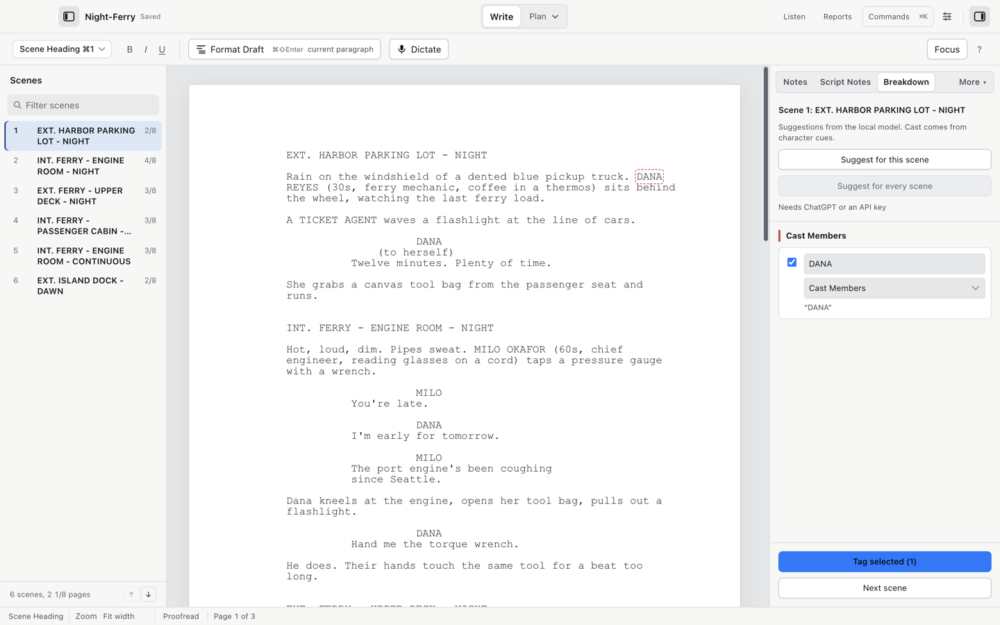

# Breakdown tagging

Breakdown tags mark text as production elements: cast, props, wardrobe, vehicles, and so on. They never change the screenplay's words, and they survive a round trip through Final Draft.

## Two ways in

Open the Breakdown panel (View > Show Breakdown) to work scene by scene, or tag stray text in place from the Tools menu.

## Tag selected text

1. Select the text in the script, for example the word "revolver" in an action line.
2. Choose Tools > Tag Selected Text….
3. Pick a Category: Cast Members, Background Actors, Stunts, Vehicles, Props, Special Effects, Wardrobe, Makeup/Hair, Animals, Music, Sound, Set Dressing, Visual Effects, Miscellaneous.
4. Give the element a name.
5. Optionally tick Replace other tags inside this selection.
6. Choose Apply breakdown tag.

The text itself is untouched. Removing a tag with the same dialog (Remove tags from selection) leaves its definition available again for reuse since the definition is stored once and referenced by position.

## Suggestions

In the Breakdown panel, the current scene is shown with the categories beside it. Choose Suggest for this scene or Suggest for every scene, and the AI provider you configured in Settings > AI proposes tags; cast comes from the character cues directly. You review and accept each suggestion; nothing tags itself.

Suggestions need an AI provider set up (see [AI setup](ai.md)). Manual tagging above needs nothing.

Tools > Suggest Breakdown Tags… runs the same suggestion pass from the menu bar.

## Review

1. View > Show Breakdown Tags overlays every tag on the script as underlined spans.
2. Tools > Reports… > Tags by scene (and Tags by tag) lists occurrences, again matching the visible sort.
3. View > Show Breakdown Tags again turns the overlay off.

## Handoff with the tags

Tags export in `.fdx` files in Final Draft's tag form. They are what [the Backlot import](backlot.md) reads, and File > Export Movie Magic Scheduling (.sex)… derives its breakdown from them.

## Video walkthrough

[Tag text and review a Backlot handoff](videos/breakdown-to-backlot.mp4) · [Captions](videos/breakdown-to-backlot.srt). See [video notes and draft narration](videos/index.md).
