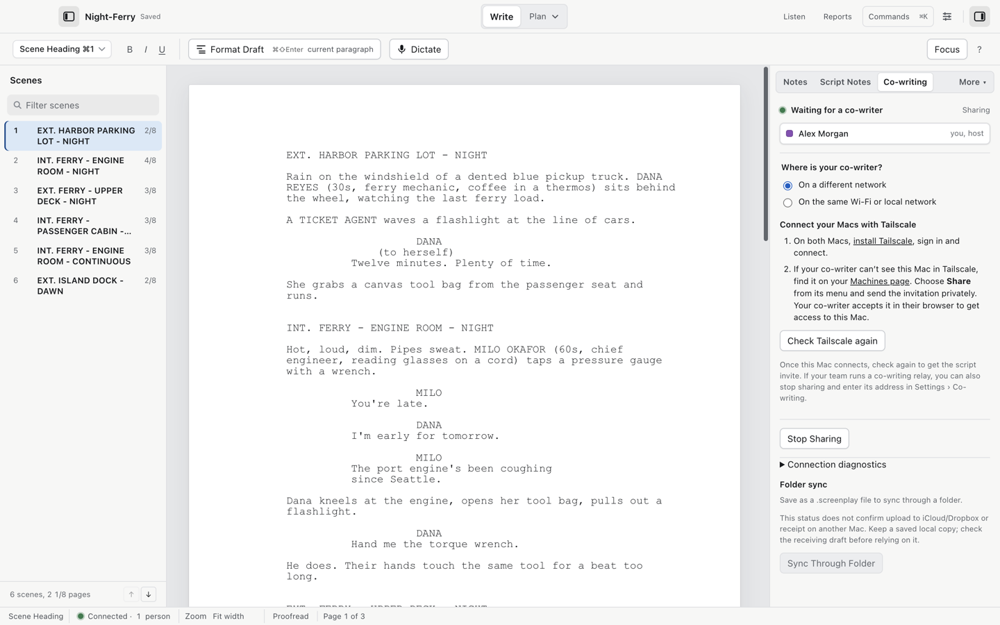

# Co-writing

Cold Open shares the live script with other writers. Everyone edits the same draft; presence and conflict notices keep changes separate instead of overwriting each other.



## Share

1. Open the `.screenplay` file you want to share. Co-writing is a native-format feature.
2. Choose File > Share for Co-writing….
3. Cold Open opens the session. Under Where is your co-writer?, choose On the same Wi-Fi or local network, or On a different network.
4. Once the selected route connects, copy the Editing invite privately to your co-writer. They open the link in Cold Open, check the invitation and choose Join. If their messaging app shows plain text, they can paste the link into File > Join Co-writing Session….

Earlier beta 8 builds show invites immediately and use an Invite over choice when Tailscale is available. The newer panel asks for the co-writer's location first.

Connection diagnostics in the panel show the local address versus a live connection, so a no-network situation is visible instead of silent.

## On the same network

Connect both Macs to the same trusted Wi-Fi or local network. Choose that route under Where is your co-writer?. If no network is found, the local option says On this Mac only; connect to the network before sending a local invite.

## In another city: Tailscale

Choose On a different network. Install Tailscale on both Macs, sign in and connect. If the co-writer cannot see your Mac, use Share on the Mac's entry in the Tailscale Machines page and send that access invitation privately. After they accept it, return to Cold Open and choose Check Tailscale again if shown. Copy the Editing invite when it appears. Keep the host Mac awake with the script open. Tailscale offers a free Personal plan for non-commercial use; check its [current plans](https://tailscale.com/pricing) for your production. Accounts belong to Tailscale.

## In another city: your own relay

Settings > Co-writing has a Self-hosted relay box. Leave it empty to share over the local network. Otherwise run the relay from a clone of this repository after installing its dependencies with `npm install`. It requires the Node version listed in the repository's `package.json`. From the repository root:

```bash
node packages/relay/src/cli.ts --port 4455 --host 0.0.0.0
```

Put the relay address in Settings > Co-writing. The [relay setup instructions](https://github.com/MIM18-code/cold-open/blob/main/packages/relay/README.md) cover its address, TLS and room lifetime. You own the relay; Cold Open and the writers' Macs send script data through it.

## The writer's name

Settings > Co-writing: "Your name, as other writers see it". Set it before you share; co-writers see this name next to edits.

## Folder sync through iCloud or Dropbox

The Co-writing panel offers Sync Through Folder: save as a `.screenplay` file inside a sync folder and other Macs pick it up. Two honest limits appear in the panel itself:

1. The shown status confirms local activity, not upload to iCloud/Dropbox or receipt on another Mac.
2. Keep a saved local copy and check the receiving draft before relying on the sync.

## Invites and leaving

File > Copy Co-writing Invite and Copy Read-only Invite re-copy the invites, read-only being what you hand Backlot or an iPhone reader. Stop Sharing ends a session hosted on your Mac. On a team relay, Leave Session disconnects your Mac. Other writers can keep working and the existing invites can still be used.

## One more thing that follows the script

Backlot can follow this same draft as it is written: see "Live script" in the [Backlot pages](backlot.md).

## Video walkthrough

[Tailscale co-writing setup](videos/cowriting-tailscale.mp4) · [Captions](videos/cowriting-tailscale.srt). See [video notes and draft narration](videos/index.md).
