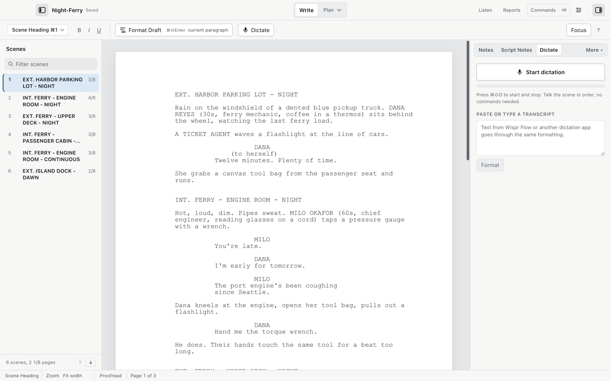

# Format Draft and dictation

Format Draft turns rough text into screenplay elements. Dictation writes the rough text in the first place.

## Format Draft

Format > Format Draft Selection / Paragraph (`⌘⇧Enter`) formats the selected text, or the current paragraph if nothing is selected, into screenplay elements.

The toolbar calls it "Format Draft" with the shortcut shown next to it.

1. Paste or type a rough passage. Wording from Wispr Flow, a dictation transcript or a friend's email all work.
2. Select it.
3. Press `⌘⇧Enter` or choose Format > Format Draft Selection / Paragraph.
4. Review the result. If a preview opens, choose Apply formatting or Keep original.

Without a selection, only the current paragraph is formatted. To preview every result before it replaces your text, turn on "Always preview before replacing the draft" in Settings > Draft formatting. It is off by default. Uncertain results, wording changes and styled text always show a preview regardless of the setting. Other results apply directly as one undoable edit.

## The formatting model

Format Draft runs on a small model on your Mac, through Ollama. No microphone is needed and no text goes to the cloud for this. To set it up:

1. Try Format Draft. If the default formatter is missing, its setup opens. You can also open Tools > Manage Local Formatting Models….
2. Choose Set up formatting on this Mac… and confirm Download model. Cold Open can install and start the local runtime for you; allow about 4 GB for the runtime and model. In earlier beta 8 builds, install and open Ollama first, then choose Refresh model status.
3. Wait for the formatter download to finish. The model is qwen3.5:4b. Cold Open displays its size as 3.10 GB, using binary units; the [Ollama registry](https://ollama.com/library/qwen3.5:4b) uses decimal sizes. This is a one-time download outside Cold Open's release.
4. Choose Pin and use this version for Format Draft. A newer download never replaces the pinned version without your say.

The same model setting lives under Settings > Dictation (Model server: Ollama, or an OpenAI-compatible server such as LM Studio on the local machine only).

## Dictation

Tools > Start/Stop Dictation (`⌘⇧D`) starts and stops recording. Talk the scene in order; no voice commands are needed. What you get is draft text on the page, in the sequence you spoke.

To set the engine, open Settings > Dictation:

1. Speech engine: Parakeet (recommended), Apple speech recognition (macOS 26 or later), or Whisper.
2. Choose Prepare engine. Cold Open includes the Parakeet speech model. You can use it offline from the first recording. Apple speech needs macOS 26 or later. Prepare engine may download and install the [system speech asset](https://developer.apple.com/documentation/speech/assetinventory) for your selected language if it is missing. Prepare it while online before recording offline.
3. Dictation button: click to start and stop, or hold to talk.

macOS asks for microphone access the first time; only recording needs it.

To format what you dictated, select the paragraphs and press `⌘⇧Enter`. The Dictate panel also accepts a pasted transcript: paste it, then choose Format.

## What each piece costs

- Cold Open itself is free.
- The local formatter model is a 3.10 GB Ollama model, downloaded once, on your disk.
- Dictation runs on your Mac. The app download includes Parakeet. Wispr Flow users can use Flow’s normal shortcut in the script editor.
- Wispr Flow, if you use it, bills under its own plan; Cold Open only receives its text.

## Video walkthrough

[Format a transcript and set up dictation](videos/format-draft-dictation.mp4) · [Captions](videos/format-draft-dictation.srt). See [video notes and draft narration](videos/index.md).
