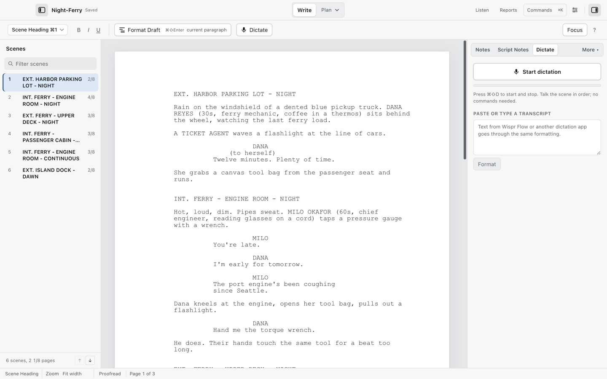

# Format Draft and dictation

Format Draft turns rough text into screenplay elements. Dictation writes the rough text in the first place.

## Format Draft

Format > Format Draft Selection / Paragraph (`⌘⇧Enter`) formats the selected text, or the current paragraph if nothing is selected, into screenplay elements.

The toolbar calls it "Format Draft" with the shortcut shown next to it.

1. Paste or type a rough passage. Wording from Wispr Flow, a dictation transcript or a friend's email all work.
2. Select it.
3. Press `⌘⇧Enter` or choose Format > Format Draft Selection / Paragraph.
4. Review the result. If a preview opens, choose Apply formatting or Keep original.

Without a selection, only the current paragraph is formatted. To preview each manual formatting result, turn on "Always preview manual Format Draft changes" in Settings > Draft formatting. It is off by default. Uncertain results, wording changes and styled text always show a preview regardless of the setting. Other results apply directly as one undoable edit.

## Automatic formatting for Wispr Flow

Turn on **Auto-format** beside Format Draft, or use Settings > Draft formatting > Automatically format incoming text. Wispr Flow's completed dictation and plain-text paste from other apps then format automatically. The option is off until you enable it.

Each incoming passage goes into its own paragraph. The cursor moves to a fresh line so you can dictate again or keep typing while formatting runs. Earlier writing stays outside the replacement range, including text before and after a paste made in the middle of a paragraph. Successive takes format in order.

If you edit or undo an incoming passage before formatting finishes, that result cannot replace your work. Turning Auto-format off cancels pending formatting and keeps the incoming text. Uncertain results or an unavailable formatter also leave the original words on the page. You can use manual Format Draft to review those passages.

A highlighted selection uses normal paste. Text copied within Cold Open keeps its existing screenplay formatting. Normal typing does not trigger automatic formatting.

## The formatting model

Format Draft runs on a small model on your Mac, through Ollama. No microphone is needed and no text goes to the cloud for this. To set it up:

1. Try Format Draft. If the default formatter is missing, its setup opens. You can also open Tools > Manage Local Formatting Models….
2. Choose Set up formatting on this Mac… and confirm Download model. Cold Open can install and start the local runtime for you; allow about 4 GB for the runtime and model. In earlier beta 8 builds, install and open Ollama first, then choose Refresh model status.
3. Wait for the formatter download to finish. The model is qwen3.5:4b. Cold Open displays its size as 3.10 GB, using binary units; the [Ollama registry](https://ollama.com/library/qwen3.5:4b) uses decimal sizes. This is a one-time download outside Cold Open's release.
4. Choose Pin and use this version for Format Draft. A newer download never replaces the pinned version without your say.

The same model setting lives under Settings > Dictation (Model server: Ollama, or an OpenAI-compatible server such as LM Studio on the local machine only).

## Dictation

Tools > Start/Stop Dictation (`⌘⇧D`) starts and stops recording. Talk the scene in order; no voice commands are needed. What you get is draft text on the page, in the sequence you spoke.

Each take continues at the end of the script, even if you left the cursor earlier in the page. Stop recording and a take that passes the formatting checks appears in the main editor. The cursor stays after the new text, ready for the next take or more typing. Undo removes one take at a time.

To replace existing text, highlight it before starting dictation. The Dictate panel shows the take for review and offers **Replace selected text**. Moving the cursor afterward does not change what will be replaced. If you edit the highlighted passage before applying the take, Cold Open keeps the take for review and refuses to replace your newer work.

Uncertain formatting and spoken edit commands also open the Dictate panel for review. Insert or discard the current take before formatting another transcript. You can type the next transcript while a take is pending; Cold Open keeps that text in its box.

To set the engine, open Settings > Dictation:

1. Speech engine: Parakeet (recommended), Apple speech recognition (macOS 26 or later), or Whisper.
2. Choose Prepare engine. Cold Open includes the Parakeet speech model. You can use it offline from the first recording. Apple speech needs macOS 26 or later. Prepare engine may download and install the [system speech asset](https://developer.apple.com/documentation/speech/assetinventory) for your selected language if it is missing. Prepare it while online before recording offline.
3. Dictation button: click to start and stop, or hold to talk.

macOS asks for microphone access the first time; only recording needs it.

For Wispr Flow, choose **Continue at end** in the toolbar to put the cursor after your script, then use Flow's shortcut. With Auto-format on, the new passage formats automatically. With it off, select the dictated passage and press `⌘⇧Enter` to format it in place. Without a selection, manual Format Draft formats the current paragraph.

The Dictate panel also accepts a pasted transcript. Paste it, choose Format, then Insert to append the result to the script. Insert returns focus to the editor so you can keep writing.

## What each piece costs

- Cold Open itself is free.
- The local formatter model is a 3.10 GB Ollama model, downloaded once, on your disk.
- Dictation runs on your Mac. The app download includes Parakeet. Wispr Flow users can use Flow’s normal shortcut in the script editor.
- Wispr Flow, if you use it, bills under its own plan; Cold Open only receives its text.

## Video walkthrough

[Format a transcript and set up dictation](videos/format-draft-dictation.mp4) · [Captions](videos/format-draft-dictation.srt). See [video notes and draft narration](videos/index.md).
