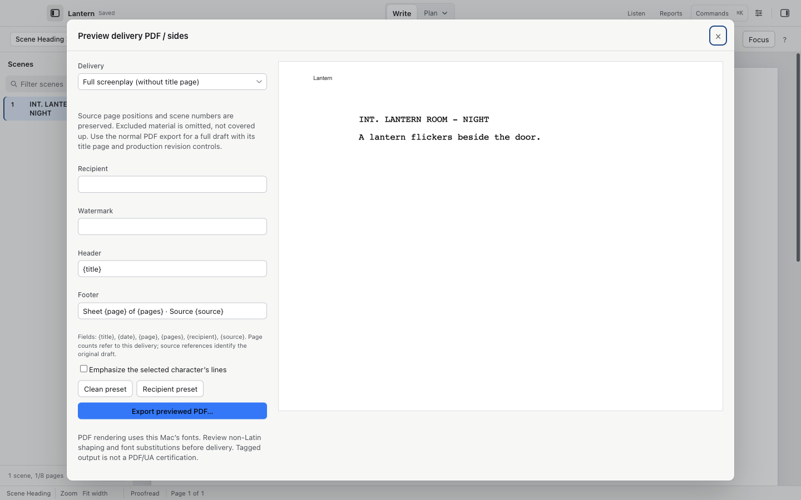

# Exports: PDF, FDX, Fountain, Movie Magic, delivery PDFs and actor sides

Everything lives in the File menu.

## Exchange formats

| Command (File menu) | Produces | Keeps |
| --- | --- | --- |
| Export Final Draft (.fdx)… | `.fdx` | Revision colors, tags, script notes, scene numbers, dual dialogue, styles. |
| Export Movie Magic Scheduling (.sex)… | `.sex` | Scene data and breakdown tags for Movie Magic Scheduling. |
| Export Fountain… | `.fountain` | Text and element types only. No revision colors, tags, locked scene numbers or script notes. |
| Save (`⌘S`) | `.screenplay` | Everything, including history identity, project material and structure points. |

Two cautions before an export:

- Draft history snapshots stay on this Mac. A `.screenplay` master preserves their identifier; neither native nor exchange files carry the snapshots to another Mac.
- If a script note lost the text it was pinned to, Cold Open blocks the FDX export and tells you, rather than silently saving a changed note. Reattach the note and export again.

File > Show in Finder reveals the saved screenplay you have open. To find an export, use the folder you chose in its save dialog.

## PDF and printing

- File > Export PDF… (`⌘⇧E`) writes the screenplay with its pagination to a PDF.
- File > Print… (`⌘P`) prints. Print Preview has a check box to print only the revised pages, and it applies to that printout only.
- Settings > Printing controls scene number placement (left, right, both, none), automatic (CONT'D), (MORE) and (CONT'D) at page breaks, header text, paper (US Letter or A4), title page, revision marks in the margin and revised pages in their revision color.

PDF export keeps every character even when the layout font has no glyph for it; the fallback borrows a system font, discloses the substitution and lets you consent first. Cyrillic and Greek render in Courier New, which is lighter than Courier.

## Delivery PDFs and actor sides

File > Delivery PDF, Watermarks and Actor Sides… previews before it exports:

1. Choose the document: Full screenplay (without title page), Actor / scene sides, or Selected elements in screenplay layout.
2. Optionally set Recipient, Watermark, Header and Footer. Fields available in header and footer: `{title}`, `{date}`, `{page}`, `{pages}`, `{recipient}`, `{source}`. Page counts refer to the delivery itself; `{source}` references the original draft.
3. Optionally tick Emphasize the selected character's lines to bold the actor's own speeches in sides.
4. Choose the Clean preset or the Recipient preset, then Export previewed PDF….

Source page positions and scene numbers are preserved, and excluded material is omitted rather than covered up. For a full draft with its title page and production revision controls, use the normal Export PDF….

The compact actor booklet, when you choose it, repaginates and carries original scene and page references so the actor can find their page in the shooting script.

PDF rendering uses this Mac's fonts. If you deliver in a script with non-Latin text, review the shaping and any font substitution before sending it out.

## Full path summary

A production workflow looks like this:

1. Tag the script (see [Breakdown tagging](breakdown.md)).
2. Export `.fdx` with the tags.
3. Import that `.fdx` into Backlot, or use File > Review Draft in Backlot… directly (see [Handoff to Backlot](backlot.md)).
4. In Backlot, use Reports for Movie Magic schedule XML and other production exports. For a `.sex` file, export directly from Cold Open as described above.

## Video walkthrough

[Export for Movie Magic Scheduling](videos/movie-magic-export.mp4) · [Captions](videos/movie-magic-export.srt). See [video notes and draft narration](videos/index.md).
