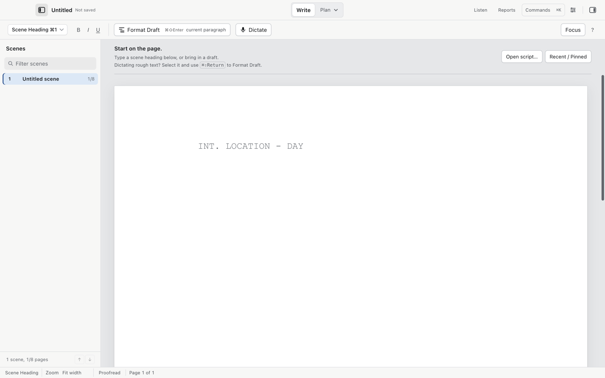

# Getting started with Cold Open

Cold Open is a free, open-source screenwriting app for the Mac. It writes screenplays with Final Draft's elements and pagination, opens and saves Final Draft (.fdx) files, and reads and writes Fountain. Co-writers, your iPhone and the Backlot production app can all follow the same script while you write.

You need an Apple silicon Mac running macOS 14 Sonoma or later. Local table-read voices need macOS 15.



## Install

Pick one of these two ways.

### Download the app

1. Open [the releases page](https://github.com/MIM18-code/cold-open/releases) (or [mindinmotionsoftware.com](https://mindinmotionsoftware.com)).
2. Download the `.dmg`.
3. Double-click the `.dmg` and drag Cold Open to Applications.
4. Eject the `.dmg`.

Or install with Homebrew:

```bash
brew tap MIM18-code/cold-open
brew trust MIM18-code/cold-open
brew install --cask cold-open
```

Homebrew requires explicit trust for third-party taps. The second command grants it for this tap; see [Homebrew tap trust](https://docs.brew.sh/Tap-Trust).

### First launch

The app is signed and notarized, so macOS shows the standard "Cold Open is an app downloaded from the Internet" question the first time:

1. Open Cold Open from Applications or Launchpad.
2. Click Open in the question.

That question appears once. After that the app opens normally.

## Cold Open is free

Cold Open costs nothing and no account is needed. Writing, saving and exports work without any AI setup. Optional downloads (see below) are separate software and use their own accounts or plans.

## Five-minute first project

1. Open Cold Open.
2. Press `⌘N` (File > New) to start a new script.
3. Type a scene heading, for example `INT. KITCHEN - NIGHT`.
4. Press Return twice. The new paragraph is Action. Type a line of action.
5. Press Return, then `⌘3`. The paragraph becomes a Character cue. Type `DANA`.
6. Press Return once. The paragraph becomes Dialogue. Type the speech.
7. Repeat with any element from the Script panel: Scene Heading `⌘1`, Action `⌘2`, Character `⌘3`, Parenthetical `⌘4`, Dialogue `⌘5`, Transition `⌘6`, Shot `⌘7`, General `⌘0`.
8. Press `⌘S` (File > Save), name the file, and save it.

Cold Open's own `.screenplay` format saves revision colors, tags, scene number locks, notes, structure points and a history identifier. History snapshots stay separately on this Mac; copying the screenplay alone does not transfer those saved versions. `.fdx` keeps Final Draft's data. `.fountain` keeps plain text only.

## Try the sample

The [Night Ferry sample script](sample/Night-Ferry.fountain) is fictional and is the script used in this guide. Download it to follow the examples with your own copy.

The [tagged Final Draft sample](sample/Night-Ferry-tagged.fdx) includes prop and vehicle tags for the import and export examples.

## Bring in an existing draft

1. Press `⌘O` (File > Open…).
2. Choose a `.fdx`, `.fountain` or `.screenplay` file.

Every page in this guide:

- [Writing and formatting](writing.md)
- [Format Draft and dictation](dictation.md)
- [Scenes and the navigator, views](scenes-and-views.md)
- [Title page, revisions and locked scene numbers](title-page-and-revisions.md)
- [Script notes and project material](script-notes.md)
- [Reports and sides](reports.md)
- [Breakdown tagging](breakdown.md)
- [Exports: PDF, FDX, Fountain, Movie Magic](exports.md)
- [Table read and voice packs](table-read.md)
- [The assistant and AI setup](ai.md)
- [Co-writing](co-writing.md)
- [The phone remote](phone.md)
- [Handoff to Backlot](backlot.md)
- [Settings](settings.md)
- [How do I…?](how-do-i.md)
- [Troubleshooting](troubleshooting.md)

## Video walkthrough

[Editor and views](videos/getting-started.mp4) · [Captions](videos/getting-started.srt). See [video notes and draft narration](videos/index.md).
