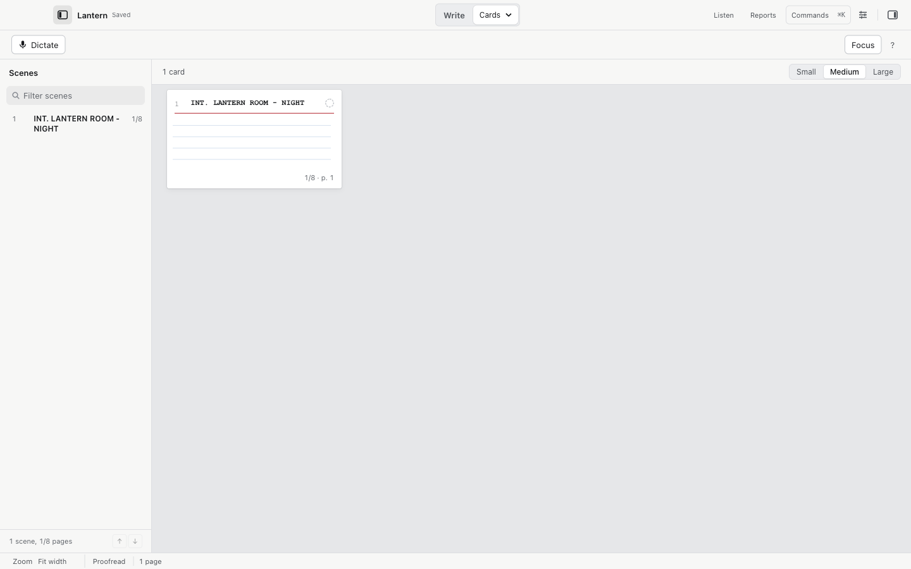
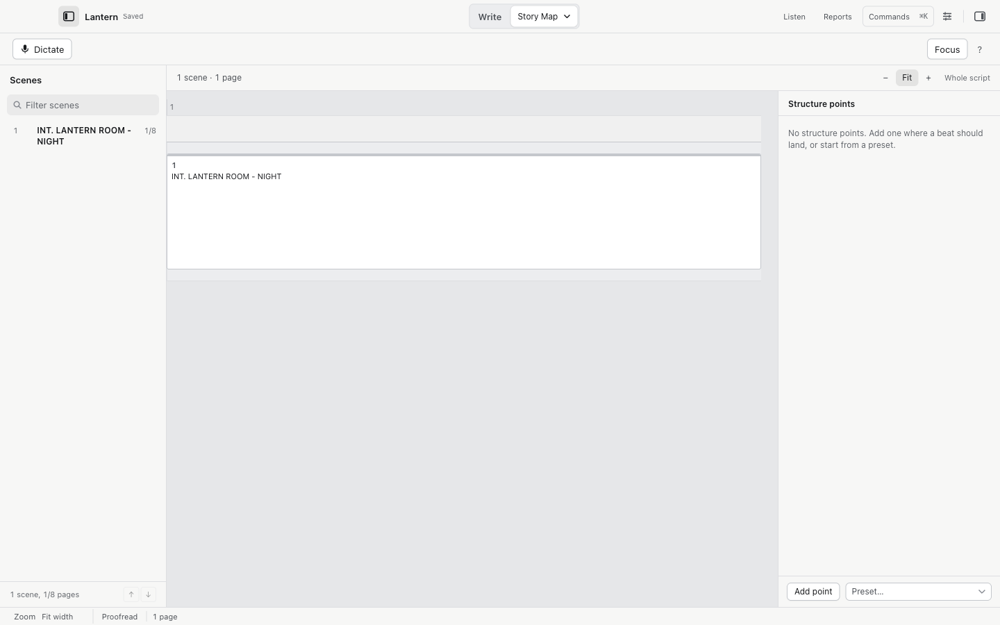

# Scenes, the navigator, and views

The left sidebar is the scene navigator. The Plan workspaces give you five more ways to see the same script.

## The scene navigator

View > Show Scenes toggles it; View > Toggle Left Sidebar (`⌘⌥S`) hides and shows the whole sidebar.

The list shows every scene with its number, its length in page eighths, and totals ("6 scenes, 2 1/8 pages"). Selecting a scene jumps the editor to it.

- Reorder with the `↑` and `↓` buttons, or drag. Keyboard-only reordering works too.
- View > Previous Scene (`⌘⌥Up`) and Next Scene (`⌘⌥Down`) walk scene to scene.
- Edit > Select Current Scene (`⌘⇧A`) selects the whole current scene.
- Script > Go to Scene… (`⌘⇧J`) opens the same list as a picker.
- View > Go to Page… (`⌘⌥G`) jumps to a page; locked page numbers such as 12A work.
- View > Back to Previous Location (`⌘⌥Left`) and Forward to Next Location (`⌘⌥Right`) retrace your cursor's path during the session, skipping deleted positions.

## Scene operations

Script > Duplicate / Move / Split / Merge Scene… opens a preview before it touches anything:

1. Choose the source scene.
2. Choose the operation: duplicate after this scene, move before another scene, split at the caret, or merge into the preceding scene.
3. Choose whether attached project notes and alternatives come along (they get fresh identities).
4. Choose Apply reviewed scene operation. Each operation is one Undo.

Numbered or page-locked drafts are refused. Split needs the caret placed in the script first.

## The views

The switcher in the middle of the title bar reads Brainstorm, Write and Plan. Write is the script page and is where Cold Open opens. Plan is a menu of the planning views. Brainstorm opens a page for loose ideas; see [Brainstorm](script-notes.md#brainstorm).

| View | Shortcut | What it shows |
| --- | --- | --- |
| Script | `⌃⌘1` | The page. |
| Cards | `⌃⌘2` | One card per scene with cast and page position, in small, medium or large. |
| Outline | `⌃⌘3` | Scene headings and lengths, collapsible sections. |
| Story Map | `⌃⌘4` | Scenes positioned by structure points you place. |
| Beats | `⌃⌘5` | Ideas parked before you promote them into scenes. |
| Canvas | `⌃⌘6` | The beat canvas: arrange beats freely or link them to scenes. |
| Brainstorm | `⌃⌘7` | A new note ready to type or dictate, with your open notes under it. |

## Story Map and structure points

A structure point marks where a beat should land, for example "end of act one". Add one with Add point, or start from a preset (Three-act, Beat sheet). Scenes align themselves to the points and the map shows the pages around each.

Fountain files cannot store structure points. Cold Open says so in the view; use Save As to keep them in a `.screenplay` file.

## Beats

Beats live in the Beats view and the Canvas. Tools > New Beat… adds an idea without touching the screenplay. Adding a beat never inserts a hidden scene; you move text into a scene yourself when you are ready.

On the canvas, drag cards anywhere, link them to existing scenes, or use the accessible list. Zoom sits at 50 to 125 percent. Moving a card never moves screenplay text.
