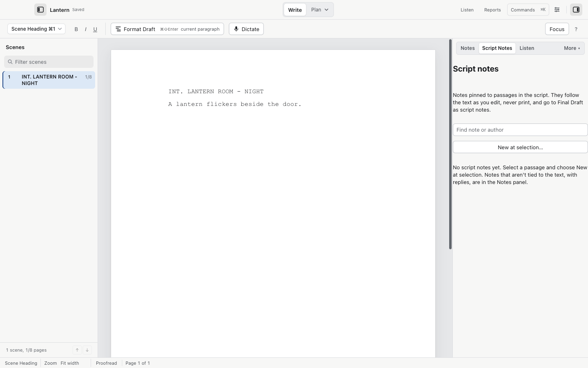
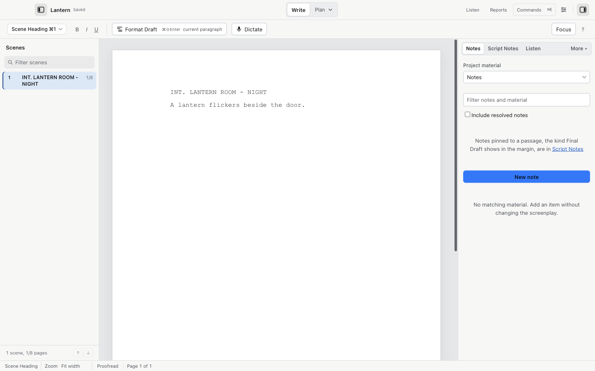

# Script notes and project material

Two note systems, each with a different job:

- Script notes ride along with the screenplay and reach Final Draft as script notes.
- Everything else (threaded notes, bookmarks, cuts, alternatives, beats) is project material that stays in your `.screenplay` file.

## Script notes

Script notes are pinned to a passage in the script. They follow the text as you edit, never print, and export to Final Draft as script notes.

1. Select the passage the note is about.
2. Choose Tools > New Script Note… (or the New at selection… button in the Notes sidebar when it is in Script Notes mode).
3. Type the note text, set an Author name and a color, and save.

Notes whose text moved away from their anchor become orphans; you can reattach them explicitly. Cold Open retains any uncommon Final Draft range data it does not understand instead of guessing a new range. Notes round-trip through Final Draft 13.

## Notes, bookmarks, alternatives, cuts and beats

The Tools menu keeps them together: Tools > Notes, Bookmarks and Alternatives opens the panel, and the shorter items create each kind:

1. Tools > New Note… (`⌘⇧M`): a note, with replies, that belongs to the project rather than one passage.
2. Tools > New Bookmark… (`⌘⇧B`): a mark at a spot in the script.
3. Tools > Save Selected Passage to Cuts…: keeps a copy of selected text and formatting without deleting anything from the draft.
4. Tools > New Alternative…: alternate wording. The script is unchanged until you swap it in, and the swap is reversible.
5. Tools > New Beat…: a planning idea that lives in Beats and the Canvas.

The panel groups them under Project material with filters: Notes, Bookmarks, Alternatives, Cuts, and Include resolved notes. Searching filters them as you type.

None of this prints or exports with ordinary script exports. Save a `.screenplay` file to keep the project material across sessions and edits.

## Editing character dialogue as a block

Tools > Edit Character Dialogue… (the Dialogue Desk) shows one character's speeches all in context: the parenthetical before, the following beat after. Edit the real source paragraphs there; the field edits apply back to the script with the normal undo and revision handling, and Apply to script is per speech.
