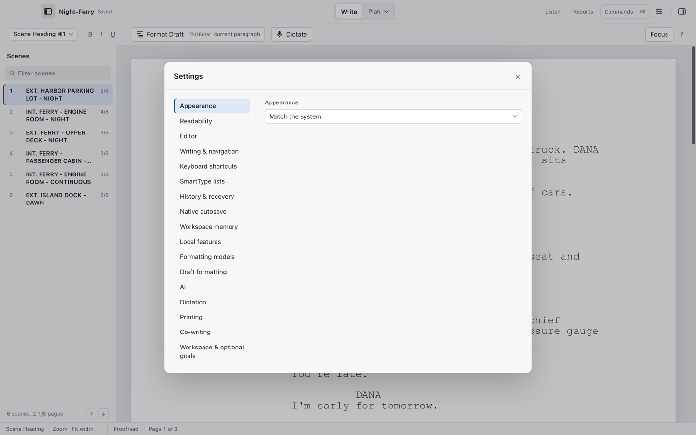

# Settings

Tools > Settings… (`⌘,`) opens a single window with these panes. A few refer to their own guide page.

| Pane | What it controls |
| --- | --- |
| Appearance | Match the system, Light, Dark. |
| Readability | Interface text size, control spacing, paper appearance (match theme, white or warm), high-contrast interface, continuous writing view. These are display only and change no page counts or exported typography. |
| Editor | Zoom (fixed percents stay fixed), and the "After Return, start a new" chain that defines element order as you type. |
| Writing & navigation | Typewriter mode, native document tabs, focus mode behavior, and the Keyboard shortcuts… button. |
| Keyboard shortcuts | Presets (Default, Final Draft elements, WriterDuet-style elements), per-command remapping, collision warnings, export/import of a map. Bare letter and Option-letter shortcuts are refused so they stay free for typing. |
| SmartType lists | Add or exclude character names, locations, transitions, times of day and cue extensions per project. Save project lists with a `.screenplay` master. |
| History & recovery | Automatic local history for saved native documents (checked once a minute); Browse draft history… |
| Native autosave | Off by default. Saves an already-saved `.screenplay` master every 30 seconds. Exchange formats are never autosaved; an externally changed file pauses autosave instead of overwriting it. |
| Workspace memory | Return to the last writing position when reopening a saved script; reopen up to 20 saved scripts and window positions at launch. Positions live in this Mac's settings, never in the file or a cloud. |
| Local features | Table-read voice packs, the Format Draft formatter, speech-helper diagnostics, optional AI provider readiness, clear generated speech cache. |
| Formatting models | The pinned Ollama model used by Format Draft (see [Format Draft and dictation](dictation.md)). |
| Draft formatting | Always preview before replacing; configure local formatter. |
| AI | Set up AI… guided setup, provider choice and keys, Advanced local address/model, sentence completion, proofreading checks, Backlot production data (see [AI setup](ai.md)). |
| Dictation | Speech engine (Parakeet recommended, Apple speech recognition, Whisper), dictation button style, model server. |
| Printing | Scene numbers, (CONT'D) behavior, header text, paper, title page, revision marks (see [Exports](exports.md)). |
| Co-writing | Your display name and the optional self-hosted relay (see [Co-writing](co-writing.md)). |
| Workspace & optional goals | Three workspace presets (writing, rewriting, rehearsal), Save current workspace, Restore saved workspace, and an optional private word goal shown in the status bar. Off by default; no streaks, reminders or analytics. |

Two panes in this window have their own dialogs in the Tools menu for reachability: Tools > Local Features and Model Readiness… opens the same Local features pane, and Tools > Manage Local Formatting Models… opens Formatting models.

## The command palette

Tools > Command Palette… (`⌘K`, or `⌘⇧P` from the Tools menu) commands everything by name, including commands whose current state makes them unavailable: they stay listed with the reason.
