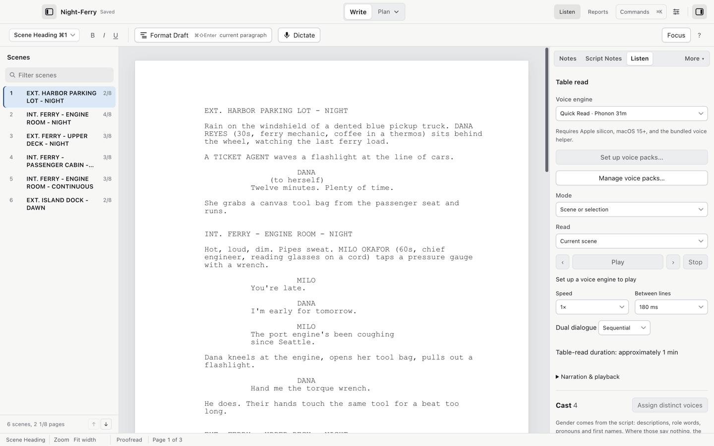

# Table read and voice packs

Tools > Table Read… (`⌘⇧L`) opens the Listen panel and reads the script aloud with distinct voices per character.

## Voice engines

The Voice engine list shows the engines and their tiers. Cold Open checks what is ready as the panel opens.

| Tier | Voices | Setup |
| --- | --- | --- |
| Quick Read | Phonon or Kokoro | Download an optional local voice pack. |
| Local presets | Ming | Download an optional local voice pack. |
| Performance | Qwen3-TTS Base | Download a compatible local voice pack. |
| Built in | Apple Premium and Enhanced voices | Install voices in System Settings > Accessibility > Spoken Content > System Voice > Manage Voices if none are installed. |

Quick Read also needs a download. It is not an already-installed fallback. Neural packs need Apple silicon, macOS 15 or later, and the bundled voice helper. The pack manager shows each pack's size, memory requirement and license before you download it.

Choose Set up voice packs… or Manage voice packs… to install a pack. You can cancel, resume and verify its download. If a pack is installed but not loaded, choose Load voice engine. Play becomes available when the engine is ready. Nothing downloads without your request.

The generated-speech cache can be cleared in Settings > Local features; clearing it never removes the model weights.

## Run a read

1. Choose the mode: Full script, Dialogue only, Scene or selection, Rehearsal, or Compare takes.
2. Choose the reading range: Current scene, Whole script, From current paragraph, or Selected paragraphs. Rehearsal tools let you loop the range, repeat a role, or Compare takes.
3. Choose Play.

Speed runs 0.75x to 1.5x; the pause between lines is 180, 400 or 800 ms, or none. Dual dialogue reads sequentially or simultaneously. The panel estimates the read's duration, for example "approximately 1 min".

Tools > Pause / Resume Table Read (`⌘⇧Space`) and Tools > Stop Table Read control playback from the menu at any time.

## Casting

The Cast section lists the speaking characters. Narration & playback controls whether action, headings, parentheticals and character names are spoken. Gender is taken from the script itself: descriptions, role words, pronouns and first names; where those say nothing, your chosen AI provider reads the character's scenes. A cloud provider asks for consent before its first casting request.

1. Choose a voice per character with Choose voice and audition it with the play button beside it.
2. Choose Recast to hear alternatives and accept only the ones you want.
3. Choose Lock to protect a choice from automatic recasting.
4. Install VoiceDesign… adds a designed voice pack for that role if you want a custom sound.

## Save and export

A `.fountain` or `.fdx` file does not store the table read. The panel offers:

1. Save table-read file next to this script: a read file that keeps voices, locks and pronunciations beside the script.
2. Export bundle… / Import bundle…: moves the whole setup to another Mac; with Include a rendered WAV it carries the audio too.
3. Export cast… / Import cast…: just the voice assignments.
4. Export this range as WAV…: writes audio. Exports use natural speed, the chosen line gap and the captured draft; playback speed, looping and role rehearsal do not affect the file.

## Read along on the phone

The Listen panel works together with the [phone remote](phone.md): received notes attach to the line being heard.

## Video walkthrough

[Table-read setup and controls](videos/table-read.mp4) · [Captions](videos/table-read.srt). See [video notes and draft narration](videos/index.md).
