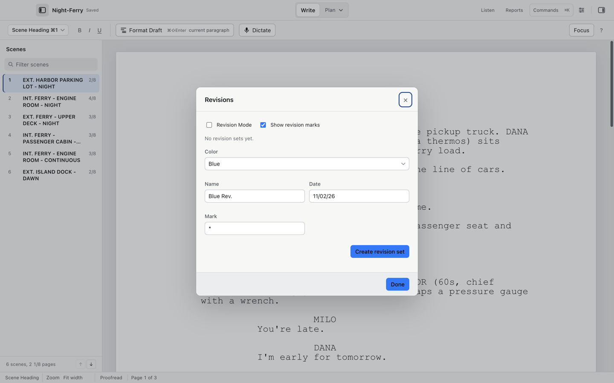

# Title page, revisions, and locked scene numbers

Everything a production draft needs lives under these two areas: File > Title Page… and the Production menu.

## Title page

File > Title Page… opens the title page editor: Title, Credit ("written by" wording), Author(s), Source, Draft date, Contact, and Copyright and notes.

1. Fill in the fields you want.
2. Choose Save.

The title sits centered a third of the way down the page, the contact block prints at the bottom left and the draft date at the bottom right. The title page prints with the script when "Print the title page" is checked in Settings > Printing.

## Number scenes

Script > Number Scenes numbers scenes 1, 2, 3. Template choice controls the style: multi-camera sitcom numbers with letters (A, B, C). Script > Remove Scene Numbers takes them off.

Locked numbers keep their value even when earlier scenes change length; A-numbers (8A) appear when scenes are inserted without renumbering the whole draft.

## Revisions

The Production menu is the revision room:

1. Choose Production > Revision Mode to start marking changes.
2. Choose Production > Current Revision… to see and clear the current set. A first set defaults to Blue dated today.
3. Choose Production > New Revision Set… to open a new color. Colors follow the standard order: White, Blue, Pink, Yellow, Green, Goldenrod, Buff, Salmon, Cherry, Second Blue, Second Pink, Second Yellow, Second Green, Second Goldenrod, Second Buff, Second Salmon, Second Cherry.
4. A mark character (an asterisk by default) can label the set. Set its Name, Date and Mark before Create revision set.
5. Changed text is marked with the set's mark; revised pages can print in their revision color (Settings > Printing).
6. Choose Production > Clear Revision Marks… when the marking pass ends. Show Revision Marks toggles display.

## Locks and omissions

Also in the Production menu:

- Lock Pages and Unlock Pages freeze page breaks so a locked page never reflows; locked numbers such as 12A are how the script stays stable across rewrites.
- Lock Scene Numbers protects the published numbers.
- Omit Scene greys a scene out with zero pages and keeps its text; Restore Omitted Scene brings it back.

## Co-writing conflicts

Two dialogs under Production help when two writers edit the same script at once:

1. Production > Scene Number Conflicts… reviews scenes that ended up with the same number; it reports when every number is already unique.
2. Production > Scene Move Conflicts… collects typing left behind by the other writer's move, so you can cut and paste it into the right place yourself. Cold Open never deletes your words.

Concurrent edits to scene numbers resolve to unique, ordered numbers, and Cold Open tells you which scene moved where.

## Draft history

File > Draft History / Named Snapshot… (`⌘⇧H`) opens the local history: up to 64 versions and 128 MB per document, with up to 20 named snapshots protected from pruning. History is stored privately on the Mac, separate from both the screenplay file and crash recovery. Name the current draft there to keep a version before a big move.

A `.screenplay` master keeps its history identity across restarts; exchange files cannot hold one.
