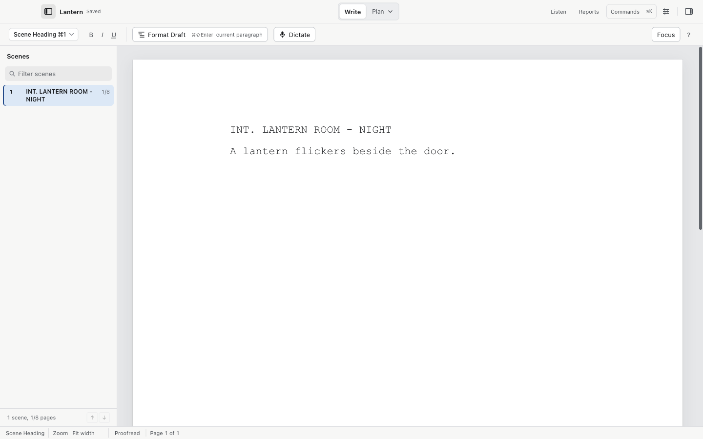

# Writing and formatting

Cold Open types like Final Draft: elements switch automatically as you write, and Return and Tab follow the same flow.

## Elements

Every paragraph in a screenplay has an element type. The Format menu and the toolbar list them all:

| Element | Shortcut |
| --- | --- |
| Scene Heading | `⌘1` |
| Action | `⌘2` |
| Character | `⌘3` |
| Parenthetical | `⌘4` |
| Dialogue | `⌘5` |
| Transition | `⌘6` |
| Shot | `⌘7` |
| General | `⌘0` |
| Lyrics | `⌘9` |
| Cast List | `⌘8` |

Other elements have no shortcut but appear in the same menu: New Act, End of Act, Section, Synopsis, Note.

Choose Character with `⌘3`, or press Tab in an empty Action paragraph. Type the character's name, then press Return once to start Dialogue.

Return advances to the next element in screenplay order. What follows what is editable in Settings > Editor (each element's "After Return, start a new" choice). Bold `⌘B`, italic `⌘I` and underline `⌘U` work as usual.

SmartType suggests character names, locations, transitions and times of day while you type. You can add or exclude entries per project in Settings > SmartType lists.

## Dual dialogue and acts

- Script > Make Dual Dialogue (`⌘⌥D`) places two speeches side by side.
- Format > New Act and Format > End of Act mark act breaks. Templates place them on their own pages.

## Templates

File > New from Template… starts a script with a template's layout and act structure:

- Feature screenplay, standard US layout.
- One-hour TV drama, a teaser and five acts.
- Half-hour single-camera comedy, a cold open, three acts and a tag.
- Multi-camera sitcom, double-spaced dialogue and lettered scene numbers.
- Stage play, centered character names and wide dialogue.

To change an existing script's layout, use Format > Document Layout and Templates…. You can edit margins and every element's indents, spacing, caps and alignment. The commit is one undoable edit and a preview shows the new page count before you apply it.

## Smart paste

Three paste choices live in the Edit menu:

1. Paste (`⌘V`) and Paste and Match Style use the clipboard's own text.
2. Edit > Paste Literal Text puts the text into the current element with no interpretation.
3. Edit > Paste Screenplay with Preview… guesses screenplay elements, shows the result before inserting, and never drops lines.
4. Edit > Smart Paste / Clean PDF Text… (`⌘⌥⇧V`) adds a cleanup pass for text copied from a PDF: you review and untick suspected page numbers, headers and footers before they are removed, and lowercase continuation lines are joined only after review.

Nothing is discarded without a preview. One Undo restores the original draft.

## Finding things

- Edit > Find… (`⌘F`), Find Next (`⌘G`), Find Previous (`⌘⇧G`).
- Edit > Find and Replace… (`⌘⌥F`) shows the changes before it applies them.
- Edit > Search Across Script Files… searches the saved versions of up to 30 scripts you choose. It looks nothing up with AI and indexes nothing outside the dialog.

## Renaming characters

Script > Rename Character… lists every character with its speech count and the names that appear in action lines. Choose one, type the new name, and every cue changes. Action-only mentions are listed separately so you can decide whether they change too.

## Document tabs and focus

- File > New Document Tab (`⌘T`) opens another script in a tab; `⌃Tab` and `⌃⇧Tab` move between them. Each tab keeps its own save state and undo history.
- View > Focus Mode (`⌘⇧F`) hides both sidebars; Escape brings them back.
- View > Typewriter Mode keeps the line you type near the center of the window.
- View > Zoom In (`⌘=`), Zoom Out (`⌘-`), Actual Size (`⌘⌥0`), Fit Script to Width. Fixed percentages stay fixed when a sidebar opens; Fit width resizes.
